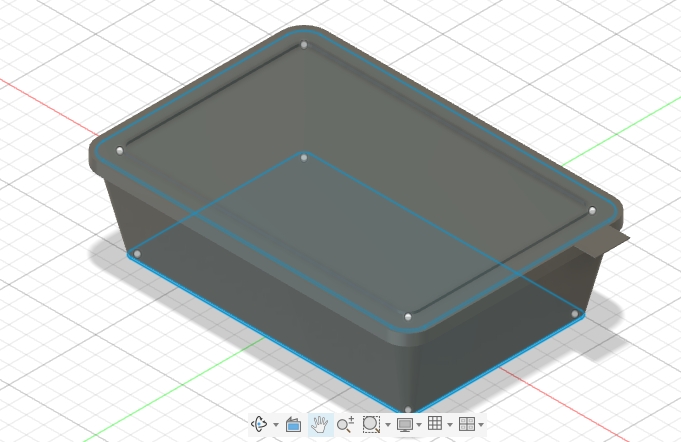

# CAD Design Portfolio

All my CAD designs in one place. Each project has its own folder with the model exports, drawings, parameter data and a write-up of the design process and how the design was checked.

**Oluwatimileyin Oluleye** · CAD Designer · [oluwatimileyinoluleye@gmail.com](mailto:oluwatimileyinoluleye@gmail.com) · [LinkedIn](https://www.linkedin.com/in/oluwatimileyinoluleye)

---

## Contractors: start here

1. Open the project folder from the table below.
2. Read its **`START-HERE.md`**. It is one page and tells you which file to open, how to check the import, and what is and is not finished.
3. Every project follows the same layout, so you always know where to look.

## Projects

| Project | What it is | Tools | Status |
|---|---|---|---|
| [Outdoor Telecom Cabinet System](projects/outdoor-telecom-cabinet-system/) ([start here](projects/outdoor-telecom-cabinet-system/START-HERE.md)) | RAN equipment cabinet with external battery cabinet: direct-air cooling hoods, 23RU rack, 12 kW DC power system and three battery strings. 3D assembly with door joints and section view, dimensioned general-arrangement drawing, specification, STEP/STL exports and multi-angle views. | Autodesk Fusion | Design complete; Rev A released |
| [23RU Outdoor Telecom Cabinet](projects/outdoor-telecom-cabinet-23ru/) ([start here](projects/outdoor-telecom-cabinet-23ru/START-HERE.md)) | Pole-mount outdoor telecom cabinet with a 23RU, 19-inch open rack, hinged louvred door, rear filter housing, sloped mudroom and monopole side port. 3D model, 4-sheet dimensioned drawing set with bill of materials, tolerances and fabrication data, specification and multi-angle views. | Autodesk Fusion | Design complete; Rev A released |
| [22U Pyramid-Canopy Outdoor Street Cabinet](projects/street-cabinet-22u/) ([start here](projects/street-cabinet-22u/START-HERE.md)) | 22U outdoor street cabinet for fibre distribution with pyramid canopy, front and side doors, base cable entries and rack frame. 3D model, 2-sheet dimensioned drawing set, specification and multi-angle views. | Autodesk Fusion | Design complete; Rev A released |
| [Orange Pi Zero 3 Enclosure](projects/orange-pi-zero-3-enclosure/) ([start here](projects/orange-pi-zero-3-enclosure/START-HERE.md)) | Gasketed, print-ready enclosure for an Orange Pi Zero 3 with LCD window, card reader, switch, reset pin and angled vents. 3D assembly, 4-sheet drawing set, specification, assembly guide and STL print files. | Autodesk Fusion | Design complete; interference-checked, print files released |
| [750 mL Takeaway Container](projects/takeaway-container-750/) ([start here](projects/takeaway-container-750/START-HERE.md)) | Stackable clear takeaway pack with snap-fit lid and integral plug seal. Drawing audit, parametric build and digital fit verification. | Autodesk Fusion | Digitally verified; physical prototype testing pending |
| [Four-Side Clip-Lock Food Container](projects/clip-lock-container/) ([start here](projects/clip-lock-container/START-HERE.md)) | Gasketed food container with four PP latch clips. Full 3D assembly, 6-sheet drawing set, specification and snap-fit validation. | Autodesk Fusion | Design complete; interference and snap-fit validated |

<!-- Add a new row here for each project. Keep the newest at the top. -->

<p align="center">
  <a href="projects/takeaway-container-750/">
    
  </a>
</p>

## How this repository is organised

```
cad-portfolio/
├── README.md                  # this index
├── projects/
│   └── <project-name>/        # one folder per design, lower-case-with-hyphens
│       ├── START-HERE.md      # one-page guide: which file to open, status, open items
│       ├── README.md          # case study: brief, process, verification, status
│       ├── CHANGELOG.md       # revision history
│       ├── cad/               # .f3d / .step model exports
│       ├── print/             # STL print files (where applicable)
│       ├── data/              # parameter tables, test results (CSV)
│       └── docs/              # drawings, images, specs
├── templates/
│   └── project-template/      # copy this to start a new project
├── .gitattributes             # Git LFS rules for large CAD/binary files
└── .gitignore
```

## Adding a new project

1. Copy `templates/project-template/` to `projects/<new-project-name>/`.
2. Fill in its `START-HERE.md` first (the one-page contractor guide), then `README.md` and `CHANGELOG.md`.
3. Export the model from Fusion into `cad/`: **File > Export** as `.f3d` (editable in Fusion) and `.step` (opens in any CAD tool).
4. Put drawings and images in `docs/`, and parameter tables and test results in `data/`.
5. Add a row to the table above.
6. Commit and push (see below).

## First-time setup

```bash
# one-time, per machine
git lfs install

# create the repo on GitHub first (empty, no README), then:
cd cad-portfolio
git init
git add .
git commit -m "Add CAD portfolio with takeaway container project"
git branch -M main
git remote add origin https://github.com/<your-username>/cad-portfolio.git
git push -u origin main
```

For each later project:

```bash
git add projects/<new-project-name> README.md
git commit -m "Add <new-project-name>"
git push
```

## Notes

- **Git LFS:** CAD files (`.f3d`, `.step`, `.stl` and similar), PDFs and videos are tracked with Git LFS (see `.gitattributes`). Screenshots (`.png`, `.jpg`) are kept as normal files so they show in READMEs and can be reused on a website. GitHub's free LFS allowance is limited (about 1 GB storage and bandwidth at the time of writing, so check current limits). If you outgrow it, keep only `.step` files and drawings in the repo.
- **Licence:** no licence is set. Add a `LICENSE` file if you want others to be able to reuse the designs; without one, all rights are reserved by default.
- **Honesty about status:** every project README states what was verified and what was not. Keep that habit.
