# Cable Connector Strain Relief Boot and Injection Mold

A complete, manufacture-ready design package for an overmolded strain relief boot for an M12-style straight cable connector, together with the split injection mold that produces it. The package covers the part design, the mold design, CNC toolpaths for machining the mold, a two-sheet technical drawing, and production-ready CAD files.

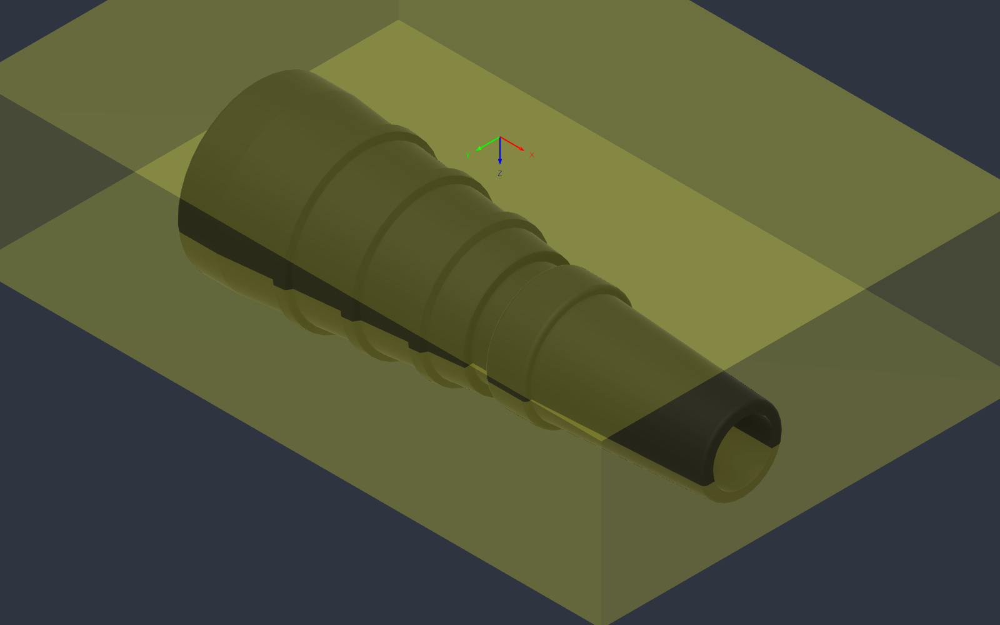

## At a glance

| | |
|---|---|
| **Part** | Strain relief boot SRB-048-01 |
| **Application** | Overmolded strain relief for a Ø6 cable entering an M12-style straight connector |
| **Material** | Nylon 6/6 (PA66) or silicone (VMQ), selected per application |
| **Process** | Injection molding in a two-half split mold, 1 cavity, central sprue |
| **Mold material** | Aluminium 6061 |
| **Design tool** | Autodesk Fusion (design and manufacturing / CAM) |
| **Deliverables** | Technical drawing (PDF), Fusion archive (F3D), STEP, STL, rendered views, Fusion CAM setups |

## Part design

The boot is a body of revolution that wraps the rear of the connector and the cable. Its profile was developed from industrial connector reference photographs: a cylindrical shoulder that seats against the coupling nut, a tapered body with three raised grip ridges, a neck groove and collar, and a long flexible tail that eases the cable bend radius.

### Specification

| Feature | Value |
|---|---|
| Overall length | 48 mm |
| Shoulder diameter | Ø16.0 mm x 4 mm long |
| Tapered body | Ø16.0 mm to Ø11.2 mm over 22 mm |
| Grip ridges | 3 off, 0.5 mm high, 1.6 mm base / 1.0 mm crest, centred 10, 16 and 22 mm from the shoulder face |
| Neck groove | Ø9.6 mm x 2 mm |
| Collar | Ø11.2 mm x 4 mm |
| Flexible tail | Ø10.0 mm to Ø8.0 mm over 16 mm |
| Connector pocket | Ø10.0 mm x 14 mm deep |
| Cable bore | Ø6.0 mm x 34 mm long |
| Minimum wall thickness | 1.0 mm (tail end) |
| Edge radii | R0.4 mm at shoulder, collar and tail end |
| Part volume | 3,613 mm3 |
| Part mass (Nylon 6/6, 1.13 g/cm3) | 4.1 g |
| Surface finish | SPI C-1 (matte) |
| General tolerances | ISO 2768-m |

### Views

| | |
|---|---|
| 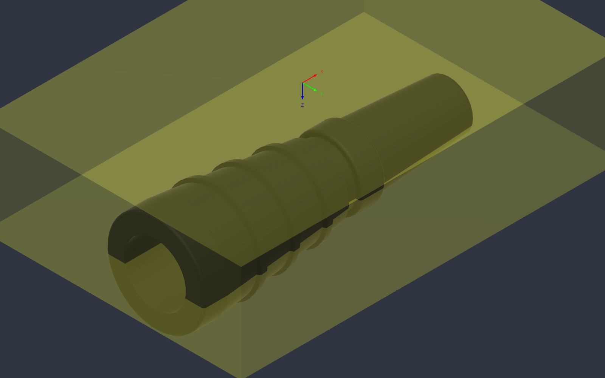 | 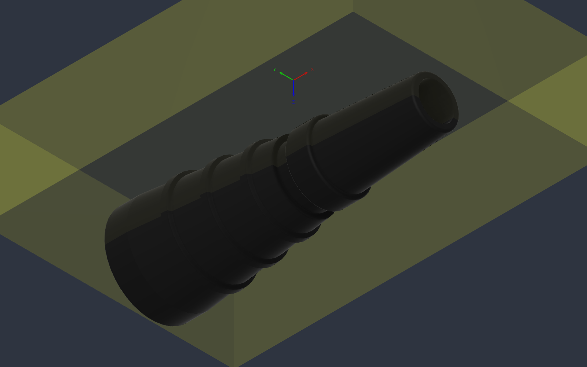 |
| 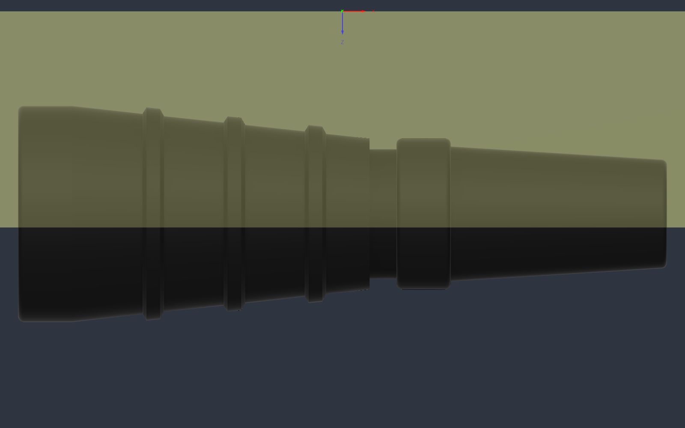 | 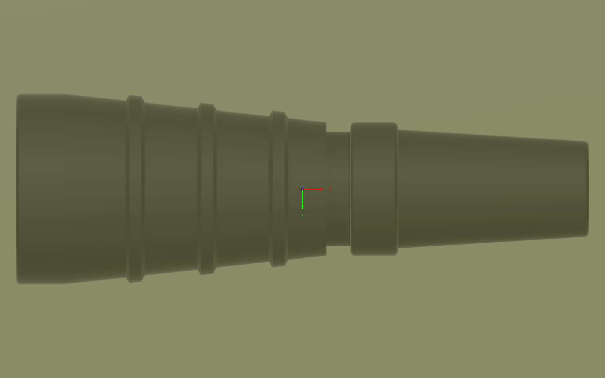 |
|  | 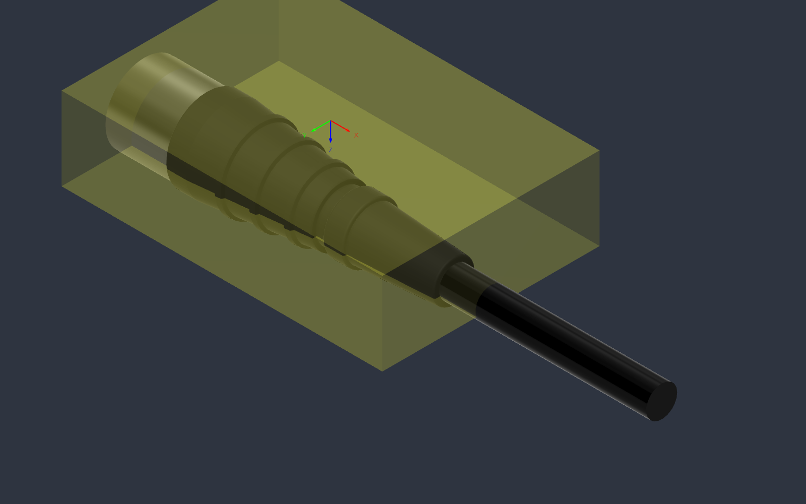 |

## Material

| Property | Nylon 6/6 (PA66) | Silicone (VMQ) |
|---|---|---|
| Character | Rigid-flexible, high strength, abrasion and oil resistant | Soft, highly flexible, wide temperature range |
| Typical use | Industrial connectors needing a firm, durable strain relief | Connectors needing a soft boot and maximum flex life |
| Density | approx. 1.13 g/cm3 | approx. 1.1 to 1.2 g/cm3 |
| Colour | Black (as modelled) | Black or per specification |

The geometry is common to both materials. Nylon 6/6 is the reference material used for the mass calculation.

## Manufacturing process: injection molding

The boot is produced by injection molding. The connector and cable are placed in the lower mold half, the mold is closed and the polymer is injected through the central sprue so that it flows around the connector rear body and the cable and forms the boot.

1. Load the connector (coupling nut seated in the nut pocket) and cable into the lower half.
2. Close the mold; four Ø6 dowel pins align the halves.
3. Inject through the Ø3 sprue in the upper half.
4. Hold, cool, open the mold and remove the finished assembly.

Recommended process window for Nylon 6/6: dried material, melt temperature 280 to 295 C, mold temperature 70 to 90 C. For silicone the mold is run hot for cure, according to the compound supplier.

## Split mold design

| Item | Specification |
|---|---|
| Mold type | Two-half split mold, parting plane on the part axis, 1 cavity |
| Block size | 60 x 40 x 30 mm (two halves, each 60 x 40 x 15 mm) |
| Mold material | Aluminium 6061 |
| Gate | Ø3 mm central sprue in the upper half, entering the cavity at the tapered body |
| Alignment | 4 x Ø6 x 12 mm stainless steel dowel pins, seated 6 mm in the lower half (Ø6.0 seats lower, Ø6.2 holes upper) |
| Insert location | Nut pocket Ø15 and cable channel Ø6 locate the connector and cable in the cavity |
| Cavity detail | Grip-ridge grooves, collar, neck groove and shoulder machined to the boot geometry |

| | |
|---|---|
| 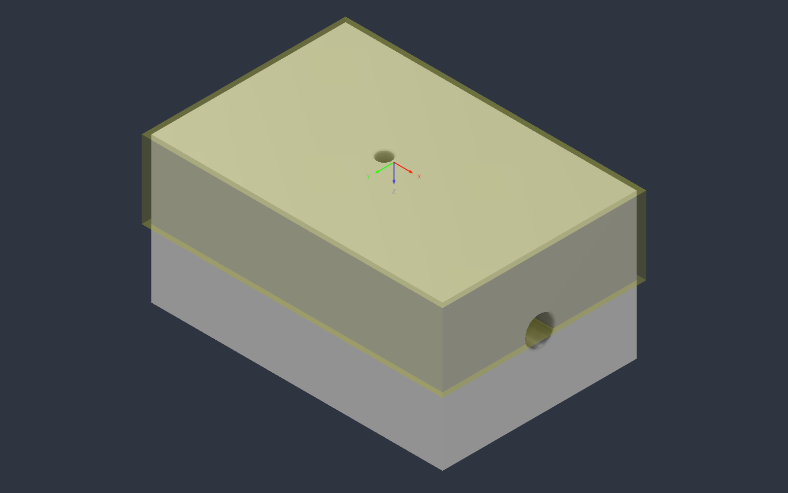 | 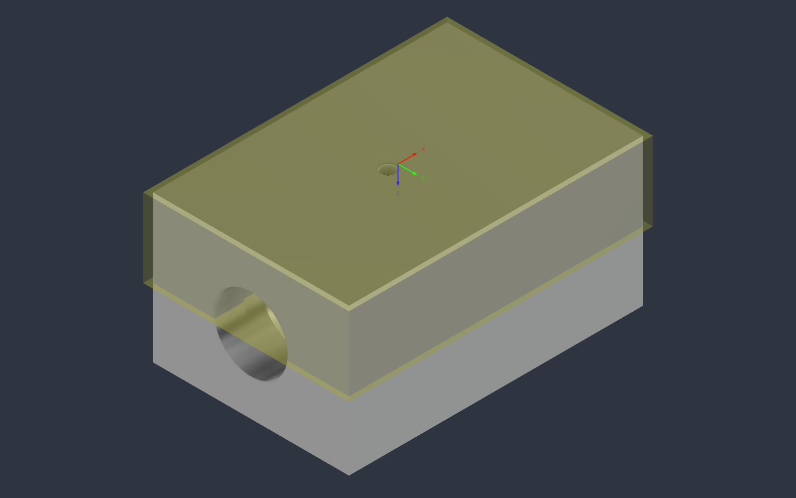 |
| 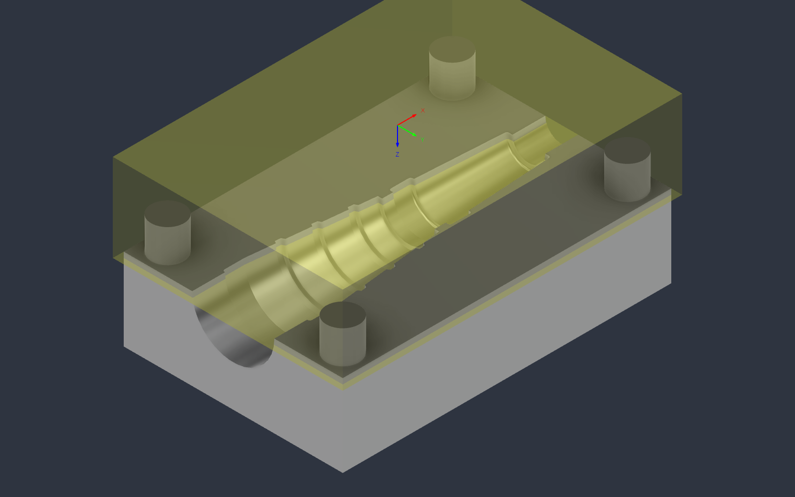 | 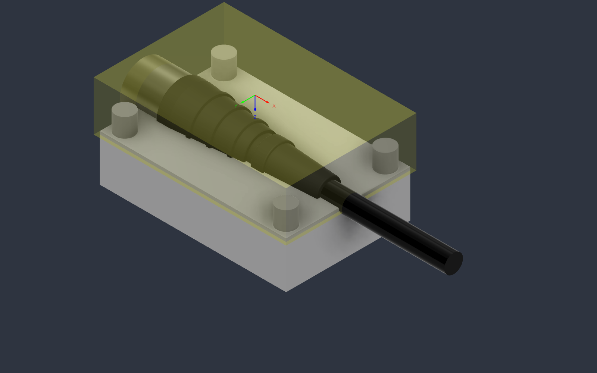 |
| 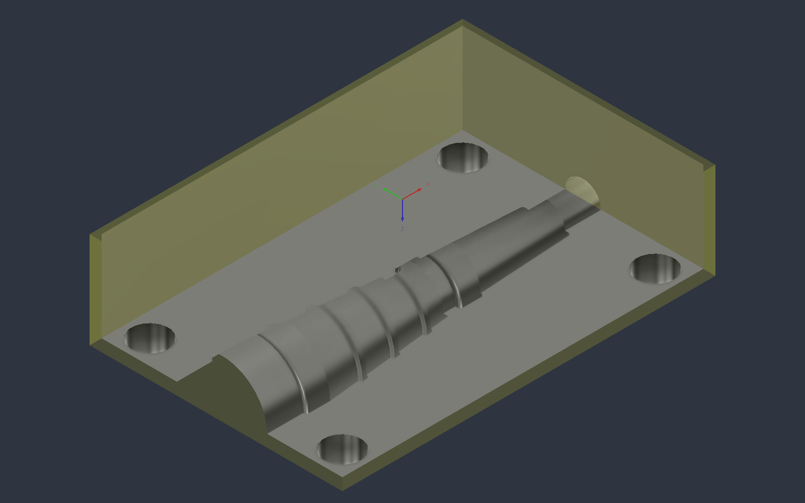 | |

## CNC machining of the mold (Autodesk Fusion Manufacture)

Both mold halves have complete CNC toolpaths, set up in three setups.

| Setup | Operations | Tools |
|---|---|---|
| Lower half, cavity | 3D adaptive roughing, parallel finishing, pencil detail, drill dowel seats | 10 mm flat end mill, 6 mm ball end mill, 1 mm ball end mill, 6 mm drill |
| Upper half, cavity | 3D adaptive roughing, parallel finishing, pencil detail, drill dowel holes | 10 mm flat end mill, 6 mm ball end mill, 1 mm ball end mill, 6.2 mm drill |
| Upper half, sprue | Drill sprue from the top face | 3 mm drill |

Estimated machining time per half (Fusion estimate): roughing 1.4 min, finishing 7.2 min, detail 0.5 min, drilling a few seconds.

## Technical drawing

[`docs/technical-drawing.pdf`](docs/technical-drawing.pdf) - two A3 sheets.

- **Sheet 1** - strain relief boot SRB-048-01: sectional view, end view, ridge detail, full dimensions, notes and parts list.
- **Sheet 2** - split mold SRB-048-MOLD: plan view, sectional view, mold specification, CNC machining summary, parts list.

## Repository contents

```
cad/
  cable-strain-relief-mold.f3d Fusion archive: design, mold and CAM setups (editable)
  strain-relief-boot.step      Boot, STEP
  strain-relief-boot.stl       Boot, STL (high-resolution mesh)
  mold-assembly.step           Full mold assembly with boot, connector and cable, STEP
  mold-lower-half.stl          Lower mold half, STL
  mold-upper-half.stl          Upper mold half, STL
docs/
  technical-drawing.pdf        Two-sheet technical drawing
images/
  01 - 12                      Rendered views of the boot and the mold
```

## Author

Oluwatimileyin Oluleye - CAD Designer
[LinkedIn](https://www.linkedin.com/in/oluwatimileyinoluleye) | oluwatimileyinoluleye@gmail.com
