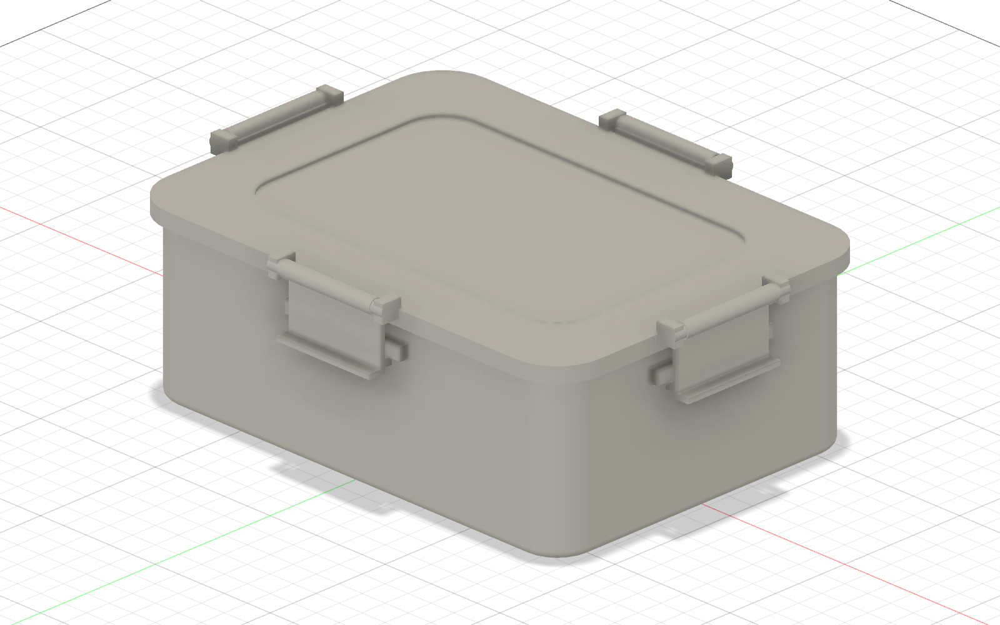
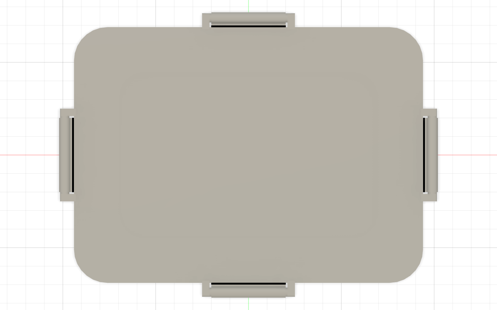
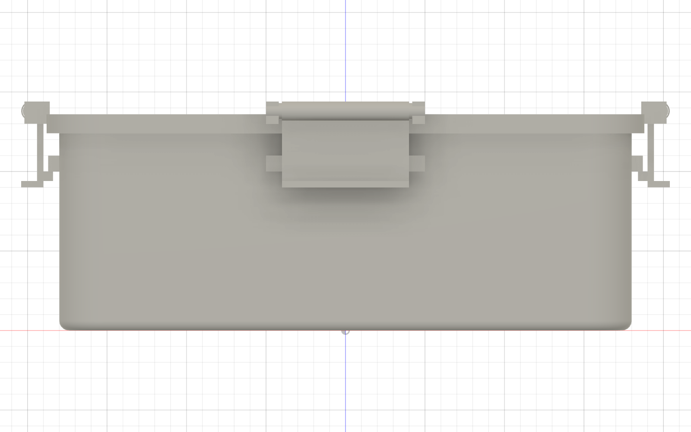
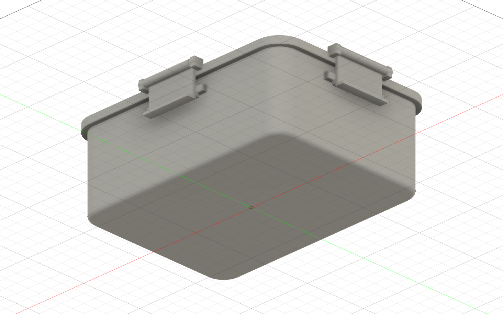

# Four-Side Clip-Lock Food Container

**Complete CAD design: 3D assembly, detailed drawing set, specification and snap-fit validation**

| | |
|---|---|
| **Project** | Rectangular food container with a gasketed lid and four latch clips |
| **Size** | 204 x 154 x 72 mm closed; body 188 x 138 x 65 mm |
| **Capacity** | approx. 1.37 L brim-full |
| **Parts** | 7: body, lid, silicone gasket, four identical clips |
| **Materials** | Polypropylene (body, lid, clips); silicone (gasket) |
| **Mass** | 200.8 g |
| **Tools** | Autodesk Fusion (modelling, assembly, drawings, interference analysis) |
| **Assistance** | Claude (Anthropic) was used for the snap-fit calculations and the documentation. |

**Quick links:** [Start here](START-HERE.md) · [Specification](docs/SPECIFICATION.md) · [Drawing (PDF)](docs/clip-lock-container_drawing.pdf) · [CAD files](cad/) · [Data](data/) · [Revision history](CHANGELOG.md)

---

## 1. Design summary

The container closes with four latch clips, one centred on each side, which pull the lid evenly onto a silicone gasket. The design was developed from a photographed lid and modelled as a full assembly with every part built separately.

| Feature | Value |
|---|---|
| Body | 180 x 130 mm walls, 2.0 mm wall, 2.5 mm floor, 65 mm tall, 188 x 138 mm rim collar |
| Lid | 188 x 138 x 3 mm plate, 140 x 90 mm recessed centre panel, four sets of catch ears |
| Gasket | 2.0 x 1.5 mm silicone ring seated in a 1.5 mm lid groove |
| Clips | 4 identical PP clips, 40 mm wide, 2 mm flexing strap, 90 degree locking ledge |
| Seal path | 185 x 135 mm |

Full details: [`docs/SPECIFICATION.md`](docs/SPECIFICATION.md).

## 2. Model views

| Top | Front |
|---|---|
|  |  |

## 3. Technical drawing

[`docs/clip-lock-container_drawing.pdf`](docs/clip-lock-container_drawing.pdf) is a 6-sheet A3 landscape drawing set (ISO, millimetres):

| Sheet | Content |
|---|---|
| 1 | Assembly isometric view |
| 2 | Assembly orthographic views with overall dimensions |
| 3 | Container body: dimensioned views |
| 4 | Container lid: dimensioned views |
| 5 | Sealing gasket: dimensioned views |
| 6 | Latch clip: dimensioned views |

## 4. Bill of materials

| Item | Part | Qty | Material | Mass total (g) |
|---|---|---|---|---|
| 1 | Container Body | 1 | PP | 128.2 |
| 2 | Container Lid | 1 | PP | 59.9 |
| 3 | Sealing Gasket | 1 | Silicone | 2.3 |
| 4 | Latch Clip | 4 | PP | 10.4 |
| | **Total** | **7** | | **200.8** |

Data file: [`data/bill_of_materials.csv`](data/bill_of_materials.csv).

## 5. Validation

**Interference check:** all seven components were checked in Fusion with no interferences found.

**Snap-fit analysis:** the clip strap (2 mm thick, 40 mm wide, about 19 mm flexing length, PP with E = 1.34 GPa and 30.3 MPa yield) was analysed as a cantilever with a 1.0 mm engagement deflection.

| Result | Value |
|---|---|
| Strain at closing | 0.83 % (PP yield strain 2.26 %) |
| Stress at closing | 11.1 MPa (yield 30.3 MPa) |
| Safety factor on yield | 2.7 |
| Closing force | 15.6 N per clip, 62.5 N for all four |
| Maximum elastic deflection | 2.7 mm |
| Clip tensile capacity | 2.4 kN per clip |
| Thermal growth, 20 to 80 C | Body +1.0 mm, lid +1.1 mm (same material, fit maintained) |

All results: [`data/validation_results.csv`](data/validation_results.csv).

## 6. Files

| Folder | Contents |
|---|---|
| [`cad/`](cad/) | `clip-lock-container.step` and `clip-lock-container.f3d` |
| [`docs/`](docs/) | Specification, drawing PDF and model images |
| [`data/`](data/) | Design parameters, bill of materials, validation results (CSV) |

## Contact

**Oluwatimileyin Oluleye**, CAD Designer
[oluwatimileyinoluleye@gmail.com](mailto:oluwatimileyinoluleye@gmail.com) · [LinkedIn](https://www.linkedin.com/in/oluwatimileyinoluleye)
