# Modern Minimalist Stainless Steel Dining Set (SDS-100)

A four-seat indoor dining set: a marble-print glass-top table on a mirror-polished 304 stainless steel frame, with four slim upholstered chairs on tapered stainless legs. Modelled in Autodesk Fusion with dimensioned drawings, STEP/STL/F3D files, specification, bill of materials and manufacturing notes.

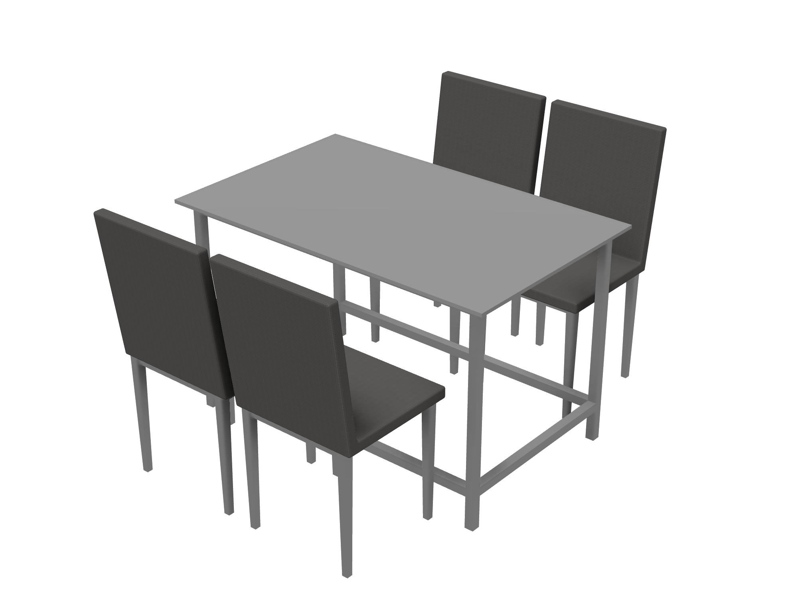

## At a glance

| | Table (SDS-T120) | Chair (SDS-C45) |
|---|---|---|
| Overall size (W x D x H) | 1200 x 750 x 750 mm | 430 x 483 x 900 mm |
| Frame | AISI 304, 30 x 30 x 1.5 mm tube | AISI 304, tapered legs 30 to 20 mm, 1.5 mm wall |
| Surface | 12 mm tempered glass, Calacatta marble print | Grey woven fabric on HR foam |
| Finish | Mirror polished (#8) | Mirror polished (#8) |
| Net mass | 39.4 kg | approx. 6.8 kg |

Seats four (two per long side). Set mass approx. 66.6 kg.

## Views

| | |
|---|---|
| 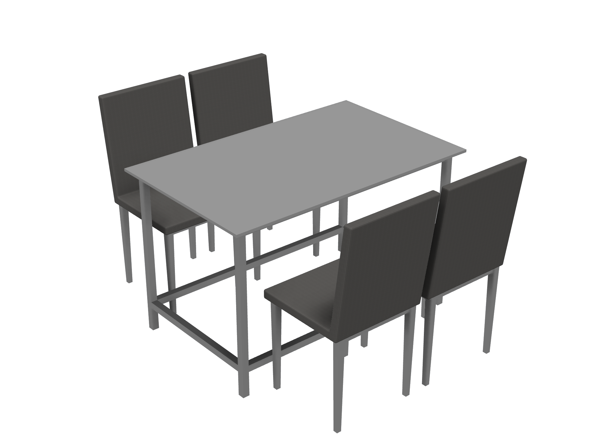 | 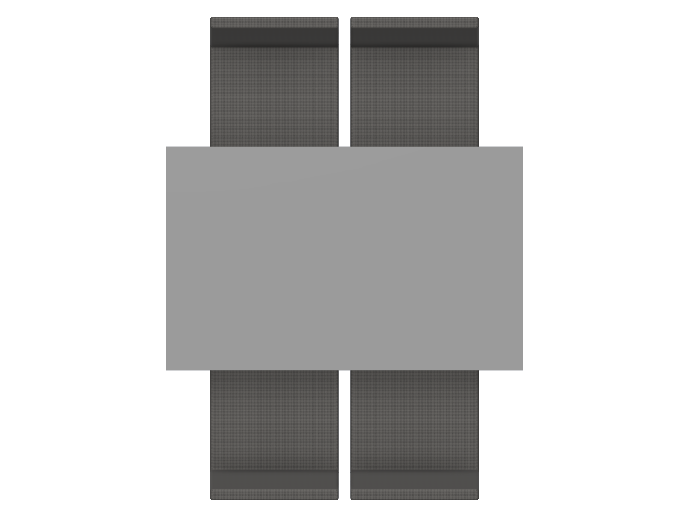 |
| 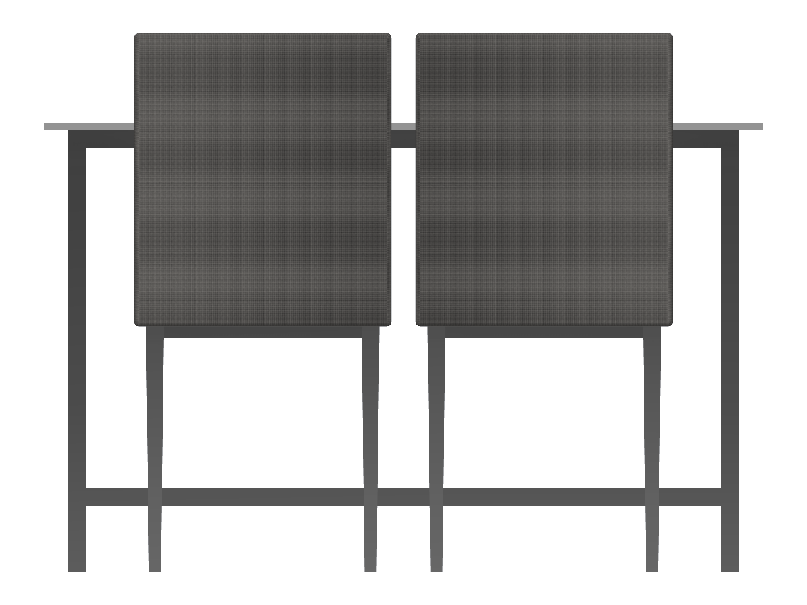 | 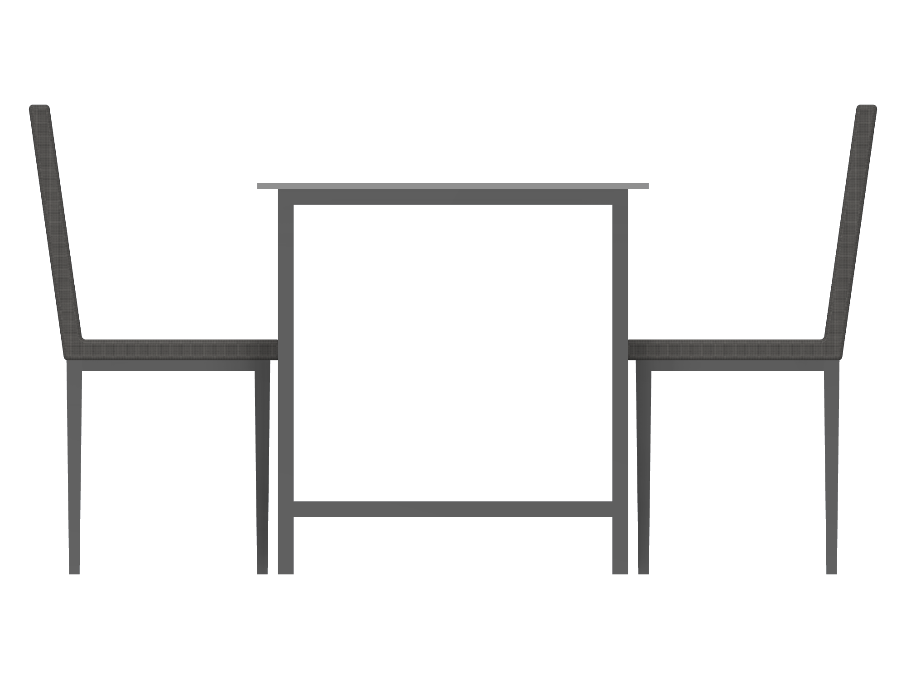 |
| 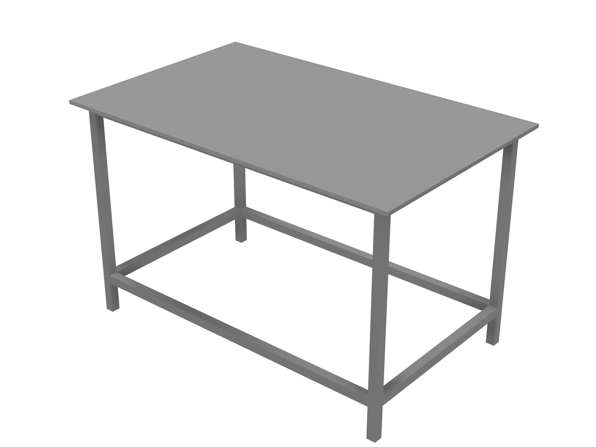 | 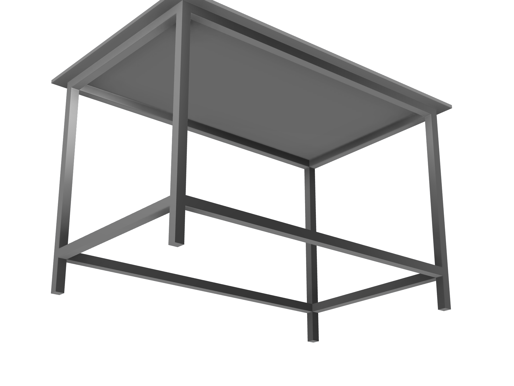 |
| 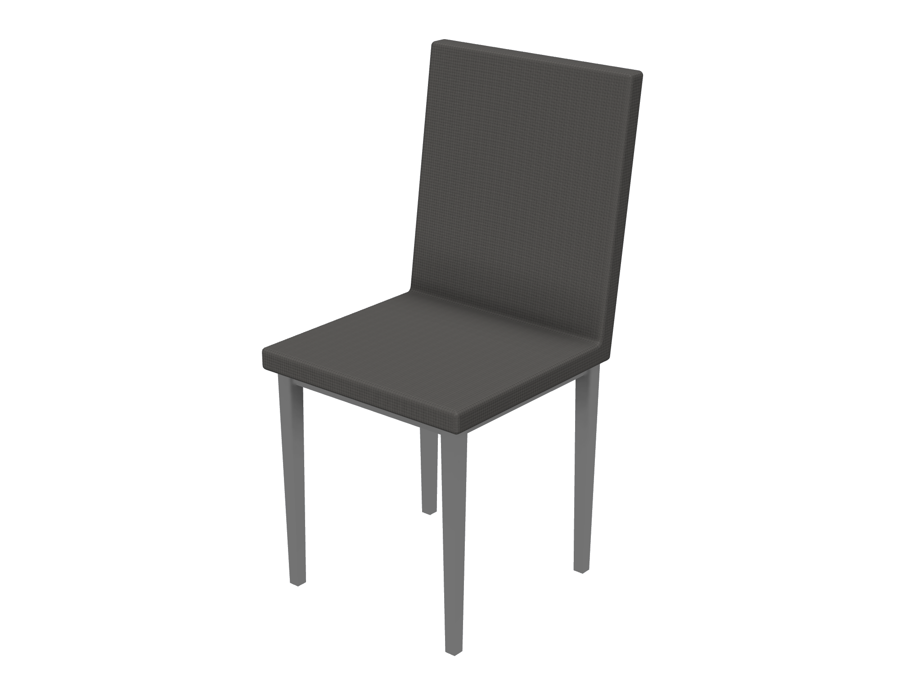 | 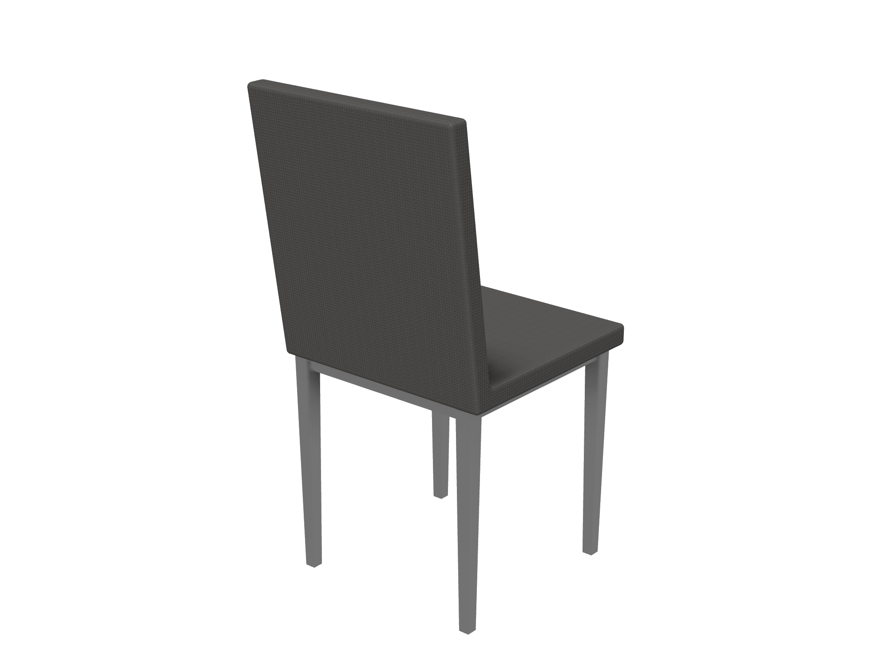 |
| 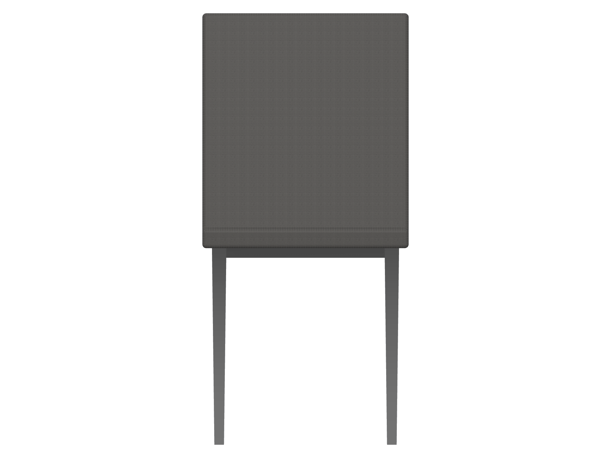 | 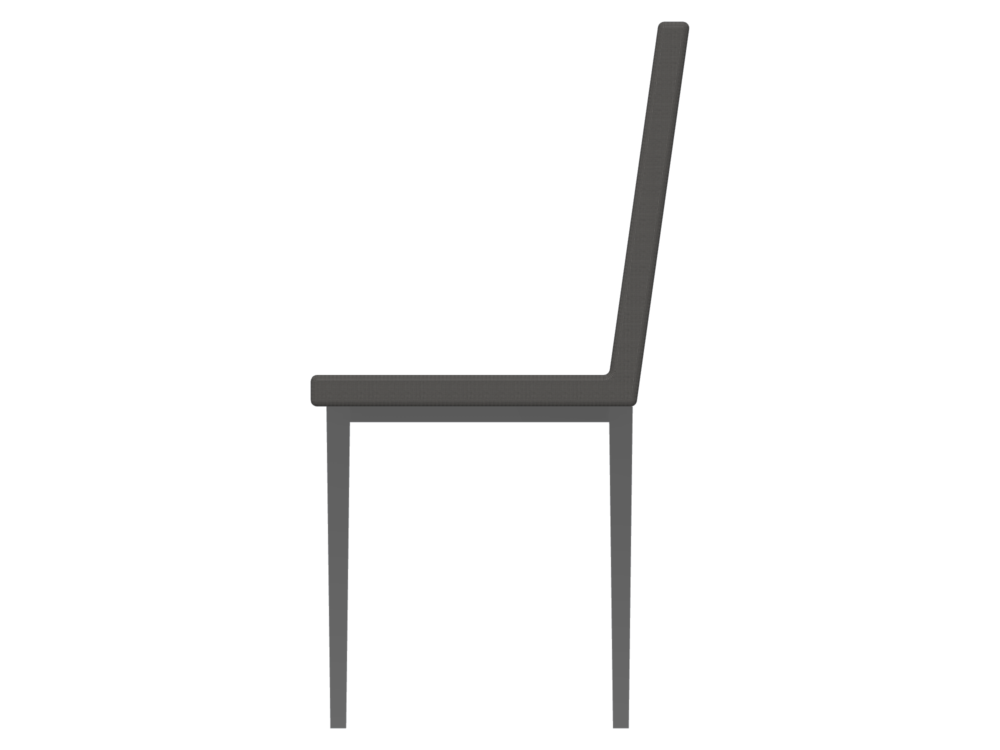 |

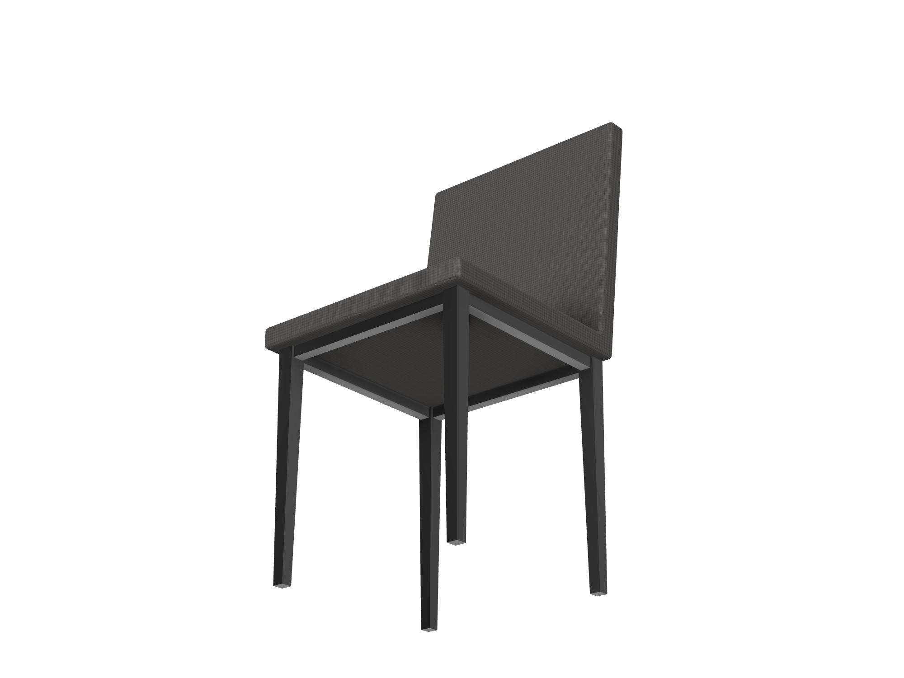

## Files

| Path | Content |
|---|---|
| `cad/Dining_Set_Assembly.step / .stl / .f3d` | Complete set: table + 4 chairs |
| `cad/Dining_Table.step / .stl` | Table only, Z-up, floor at Z = 0 |
| `cad/Dining_Chair.step / .stl` | Single chair, Z-up, floor at Z = 0 |
| `docs/drawings/SDS-T120-GA-01_Dining_Table` | Table general arrangement (PDF + SVG) |
| `docs/drawings/SDS-C45-GA-02_Dining_Chair` | Chair general arrangement (PDF + SVG) |
| `docs/drawings/SDS-100-LAY-03_Set_Layout` | Four-seat layout and clearances (PDF + SVG) |
| [`docs/PRODUCT_SPECIFICATION.md`](docs/PRODUCT_SPECIFICATION.md) | Full specification |
| [`docs/BILL_OF_MATERIALS.csv`](docs/BILL_OF_MATERIALS.csv) | Bill of materials |
| [`docs/MANUFACTURING_NOTES.md`](docs/MANUFACTURING_NOTES.md) | Fabrication, assembly and quality checks |

## Design highlights
- Rectilinear table with a 40 mm glass overhang and a low stretcher frame for rigidity.
- Welded, end-capped stainless tube construction with no exposed fasteners on the table.
- Slim chair: 8 degree back rake, 450 mm seat height, tapered legs, R8 upholstered edges.
- Chairs tuck 45 mm under the table; seat-to-table clearance 300 mm.

## Verification
- Assembly interference check: 0 interferences between table and chairs.
- Dimensions in the drawings, specification and CAD model are consistent (taken from the Fusion model).
