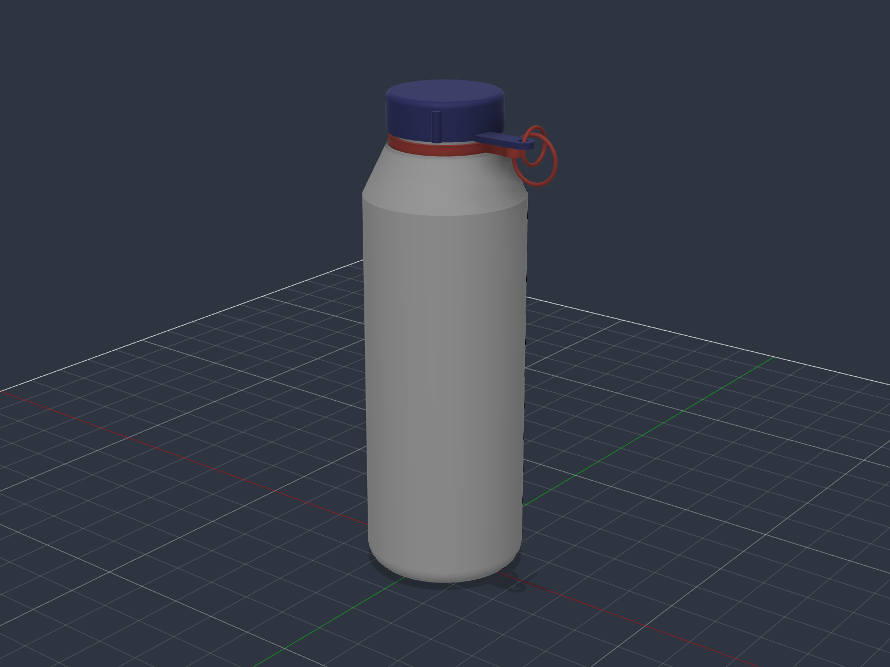
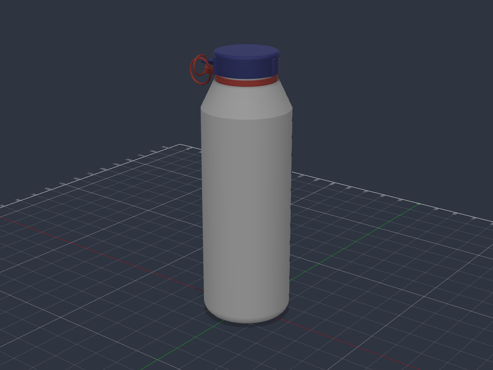
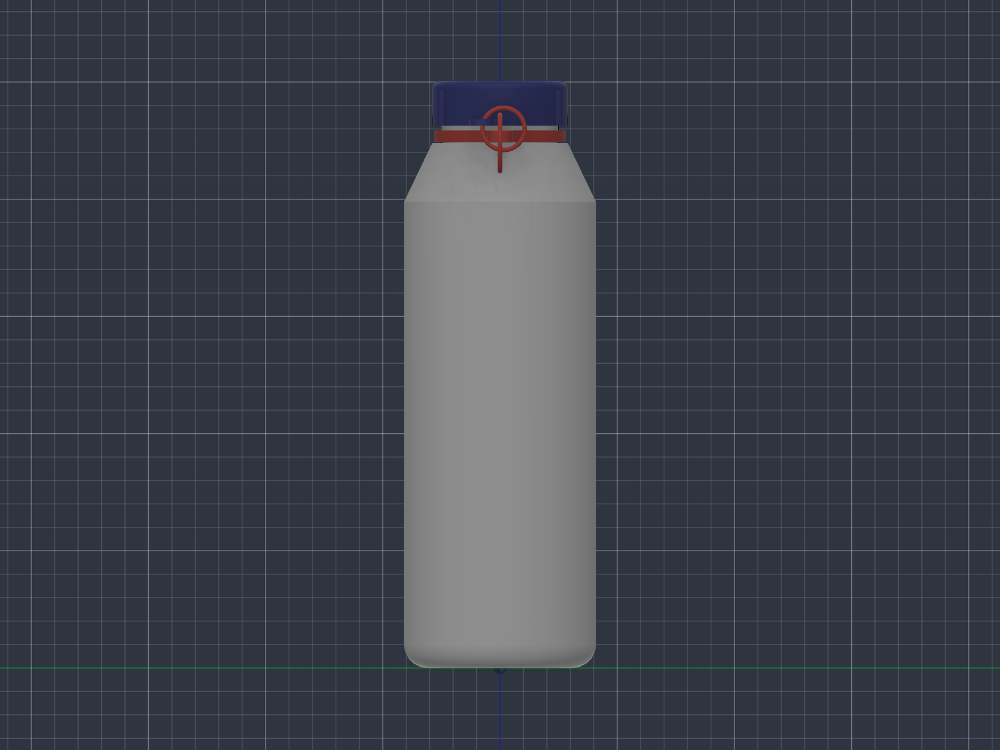
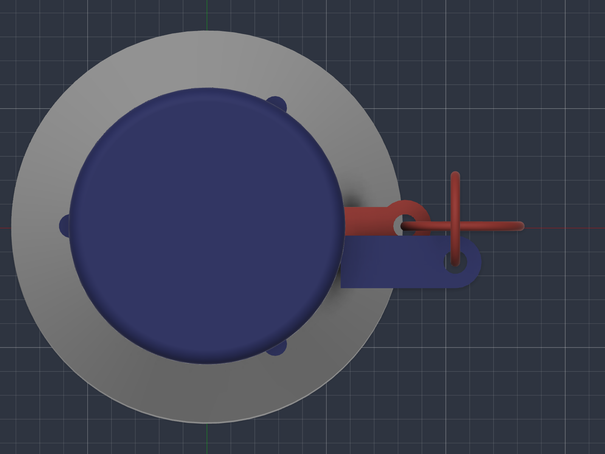
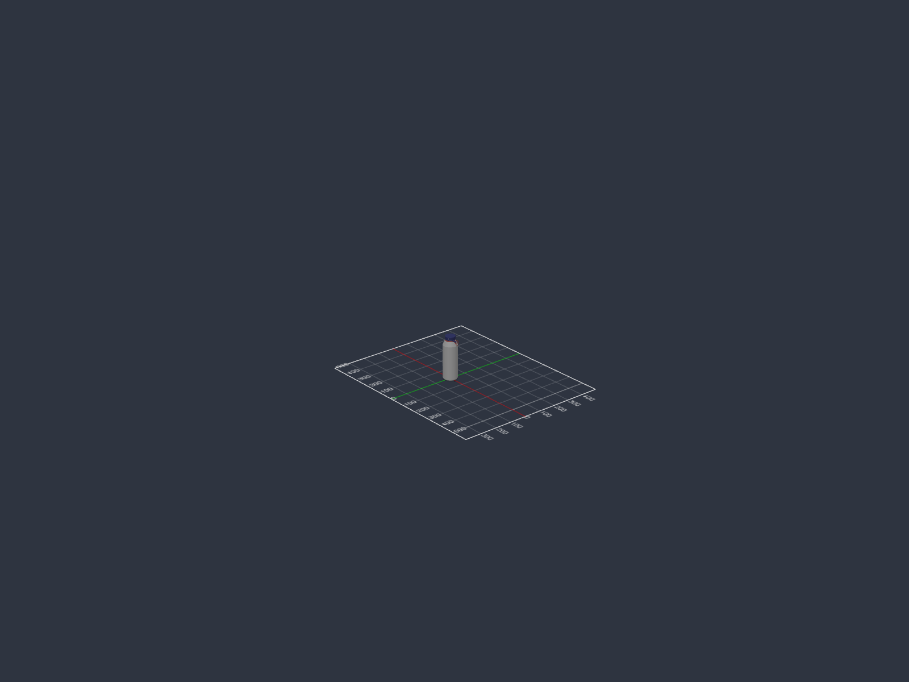
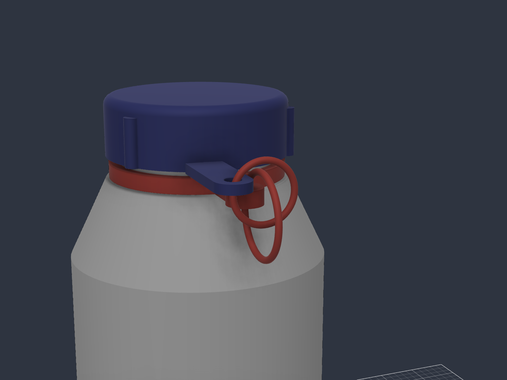
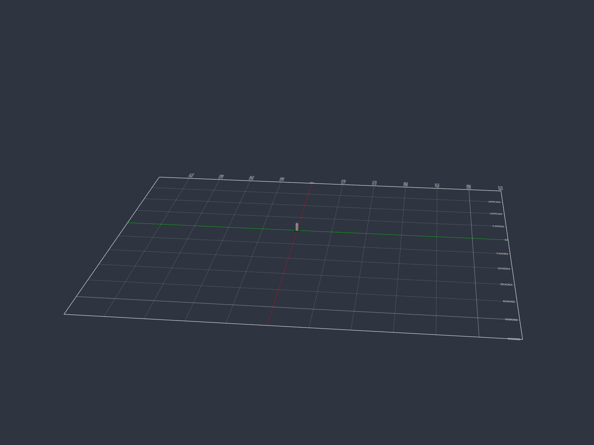
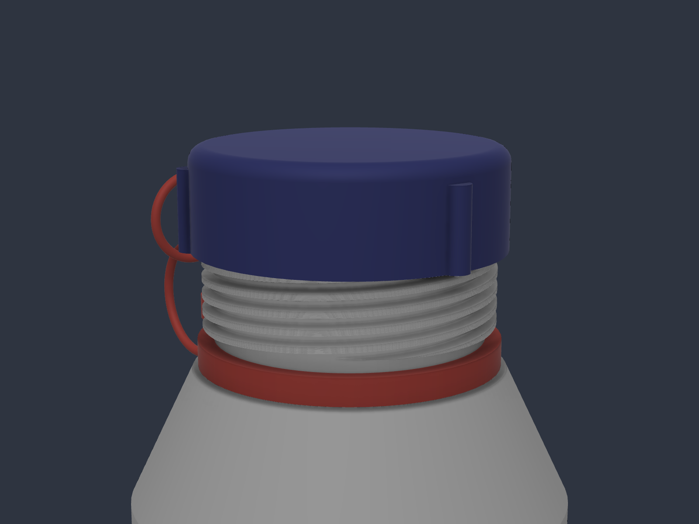
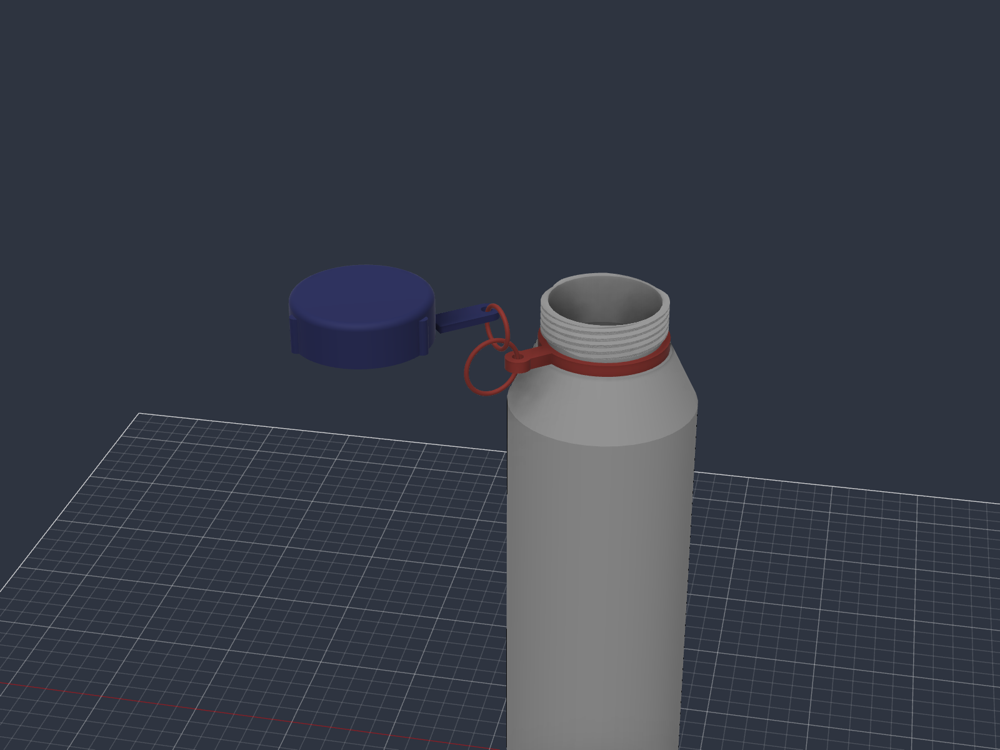

# One-Litre Threaded Water Flask (WF-001)

A portable one-litre water flask designed as a complete, dimensioned CAD product: a food-contact polypropylene body and screw cap, a silicone face gasket, and a silicone strap that keeps the cap attached to the bottle through two interlinked link rings.



**New here? Read [START-HERE.md](START-HERE.md) first.**

## Highlights

- **1.00 L capacity to the brim** (CAD cavity volume 1000.1 mL) in a hand-friendly 82 mm diameter body.
- **Fast 3-start thread:** lead 9.0 mm, so the cap releases after about 1.6 turns (580 deg, 14.5 mm of travel). Three entry points, 120 deg apart.
- **Face-gasket seal:** a 2.0 mm silicone gasket seats on a flat neck land with 0.5 mm of squeeze when closed. The thread provides clamp load; the gasket makes the seal.
- **Captive cap:** a strap ring turns freely on the neck and is joined to the cap lug by two interlinked silicone rings. The cap lifts clear, then swings aside on the rings, leaving the mouth fully open.
- **Fully clearanced thread:** 0.15 mm axial and 0.25 mm radial clearance, with no interference at any rotation across the 14.5 mm travel.
- **Light:** 190.9 g empty (calculated from CAD volumes and nominal densities).

## Gallery

Renders of the CAD model. Colours are illustrative: grey body, blue cap, red silicone strap and rings, white gasket.

| | |
|---|---|
|  |  |
| Isometric, front right | Isometric, back left |
|  |  |
| Front elevation | Side elevation |
|  |  |
| Top view: cap, grip lobes, lug and rings | Cap, strap ring and lug close-up |
|  |  |
| Interlinked silicone link rings | Cap fully unscrewed (14.5 mm lift, 580 deg) |
|  |  |
| 3-start neck thread | Cap swung aside on its rings, mouth open |

## Product at a glance

| | |
|---|---|
| Capacity (brim) | 1000 mL |
| Overall height, closed | 250.4 mm |
| Body diameter / wall | 82 mm / 3.0 mm |
| Cap diameter | 58 mm (62 mm over grip lobes) |
| Neck thread | 3-start, right-hand, pitch 3.0, lead 9.0 |
| Thread major / minor | 54.0 / 50.0 mm (+-0.15) |
| Neck bore | 48.0 mm |
| Mass, empty | 190.9 g |
| Materials | Food-contact PP (body, cap); food-grade silicone (gasket, strap, rings) |

## Parts

| Item | Part | Material |
|---|---|---|
| 1 | Flask body | Food-contact PP |
| 2 | Screw cap with 3-start internal thread | Food-contact PP |
| 3 | Cap gasket 48 / 54 x 2.0 | Food-grade silicone |
| 4 | Captive strap (ring, tether, eye) | Food-grade silicone |
| 5 | Link ring A (wire 2.0, 26 OD) | Food-grade silicone |
| 6 | Link ring B (wire 2.0, 20 OD) | Food-grade silicone |

Full bill of materials: [data/bill_of_materials.csv](data/bill_of_materials.csv). Adjustable values: [data/design_parameters.csv](data/design_parameters.csv).

## How it works

1. **Open:** turn the cap counter-clockwise. It rises 9.0 mm per turn, and the strap ring turns with it on the neck.
2. **Release:** at 14.5 mm (580 deg) the cap is free of the thread.
3. **Swing aside:** the cap swings 180 deg about its lug hole on the link rings, clear of the mouth.
4. **Close:** swing the cap back over the mouth and turn clockwise until the gasket seats.

See [docs/ASSEMBLY_AND_OPERATION.md](docs/ASSEMBLY_AND_OPERATION.md).

## Technical drawings

Five A3 sheets, drawing WF-001 Rev B, in [docs/drawings/](docs/drawings/): SVG sheets plus a combined PDF ([WF-001_drawing-set.pdf](docs/drawings/WF-001_drawing-set.pdf)).

| Sheet | Content |
|---|---|
| [1](docs/drawings/WF-001_sheet1_general-assembly.svg) | General assembly: front elevation, top view, strap-lug-ring detail, parts list, key specification |
| [2](docs/drawings/WF-001_sheet2_body.svg) | Flask body: half section, neck thread profile, thread plan section |
| [3](docs/drawings/WF-001_sheet3_cap-gasket.svg) | Cap section, underside view, gasket seat |
| [4](docs/drawings/WF-001_sheet4_strap-rings.svg) | Strap plan and section, link rings, ring linkage |
| [5](docs/drawings/WF-001_sheet5_thread-mesh-motion.svg) | Thread mesh at 10:1, opening sequence, swing-aside path, fit and motion checks |

## Design verification (CAD)

Checks were carried out on the 3D model and by calculation from the thread profile geometry.

| Check | Result |
|---|---|
| Internal volume to the top of the neck | 1000.1 mL |
| Thread clearance per flank, axial / radial | 0.15 mm / 0.25 mm |
| Minimum radial gap between cap thread and neck thread, all angles, lift 0 to 14.5 mm | 0.24 mm |
| Thread interference at any rotation 0 to 580 deg | none |
| Solid-model sampling at cap lifts of 0, 3, 6, 9, 12 mm | no points inside both solids |
| Cap seated | coaxial, skirt 58 mm true at six angles and two heights |
| Cap underside to neck top, closed | 0.5 mm gap, gasket contacts first |
| Cap rim to strap ring, closed | 2.0 mm clear |
| Rings against body, cap, gasket, strap and each other | no overlaps; rings pass through their holes |
| Ring chain through cap lift 0 to 16 mm | rings clear of strap, lug and each other |
| Cap swing about lug hole, 0 to 180 deg | no contact with rings; cap ends about 105 mm from the bottle axis, clear of the mouth |

## Files

```
one-litre-water-flask/
|-- START-HERE.md
|-- README.md
|-- CHANGELOG.md
|-- cad/        STEP and Fusion files
|-- print/      assembly STL and one STL per part
|-- data/       bill of materials, design parameters
`-- docs/
    |-- SPECIFICATION.md
    |-- ASSEMBLY_AND_OPERATION.md
    |-- drawings/   5 SVG sheets + combined PDF
    `-- images/     10 renders
```

Tools: Autodesk Fusion.
