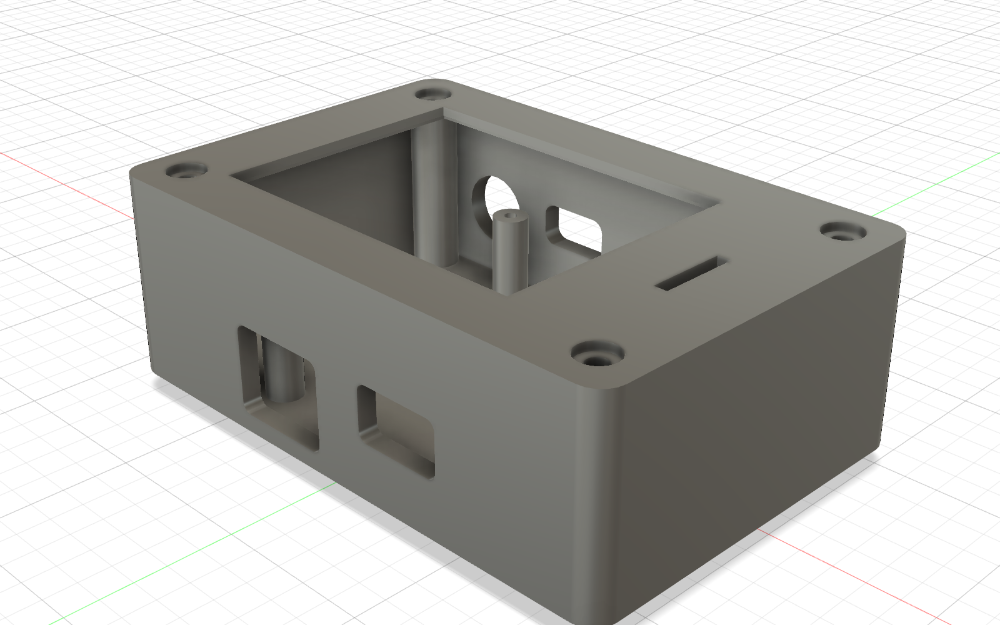
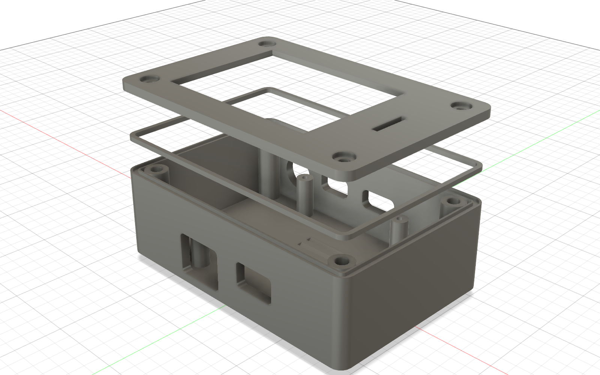
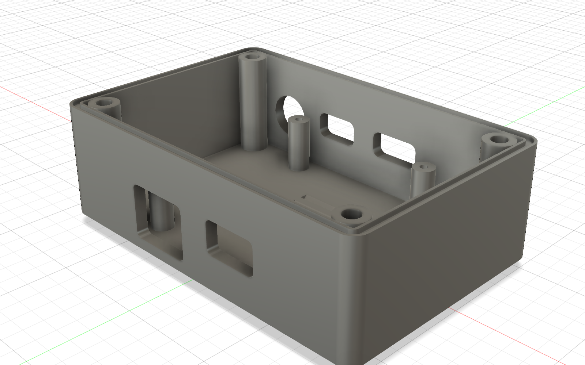
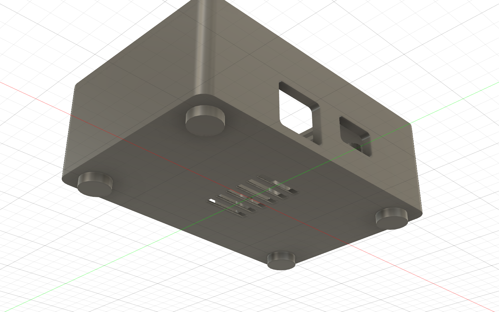
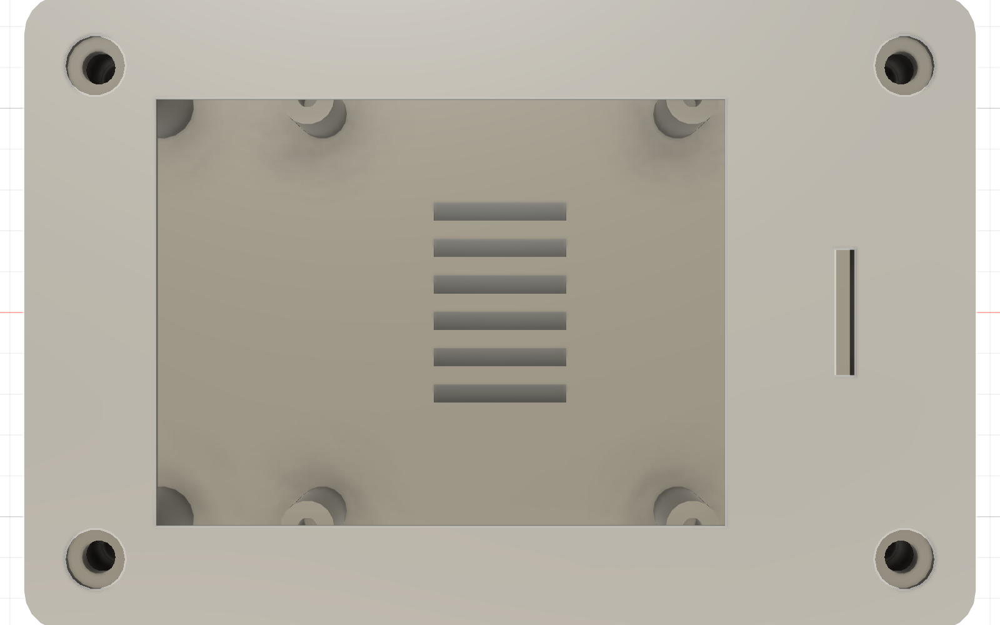
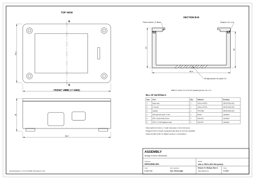

# Orange Pi Zero 3 Enclosure

**A compact, gasketed, 3D-print-ready enclosure with a front LCD window, card-reader slot, power switch, reset pin and an angled-vent heat path**

| | |
|---|---|
| **Project** | Splash- and dust-resistant enclosure for an Orange Pi Zero 3 with heat sink, 2.8 in LCD, card reader, on/off switch and reset pin |
| **Size** | 96.4 x 64.4 x 36 mm (rear feet to lid face); 96.4 x 64.4 x 33 mm without feet |
| **Parts** | 3 printed parts (base tray, front lid, TPU gasket) plus standard M2.5 / M3 hardware |
| **Materials** | ASA or PETG (tray, lid); TPU 95A (gasket) |
| **Mass** | 60.9 g solid-model mass in ASA and TPU |
| **Print** | No supports; every part prints flat on its largest face |
| **Tools** | Autodesk Fusion (parametric modelling, assembly, interference analysis) |
| **Assistance** | Claude (Anthropic) was used for design development, drawings and documentation. |

**Quick links:** [Start here](START-HERE.md) | [Specification](docs/SPECIFICATION.md) | [Assembly guide](docs/ASSEMBLY.md) | [Drawings](docs/drawings/) | [CAD files](cad/) | [Print files](print/) | [Data](data/) | [Revision history](CHANGELOG.md)

---



## 1. Design summary

The enclosure is a two-piece clamshell. The Orange Pi Zero 3 is mounted component-side down on four 14.5 mm standoffs, so its heat sink faces the rear wall, directly above a field of six angled vent slots. The LCD and card reader sit in the front lid and are used without opening the box. A TPU gasket in a rim groove seals the lid, and four M3 screws into heat-set inserts hold it closed and let it come off for maintenance.

| Feature | Specification |
|---|---|
| Footprint | 96.4 x 64.4 mm, 4 mm corner radius |
| Cavity | 90 x 58 mm, 27.6 mm deep above the 2.4 mm rear wall |
| Walls | 3.2 mm side walls, 2.4 mm rear wall, 3.0 mm lid |
| Board mounting | 4 standoffs, 14.5 mm tall, 43 x 48 mm hole pattern |
| Heat path | 6 angled louvers (45 deg, 16 x 2.2 mm) behind the heat sink, 4 rear feet 3 mm tall |
| Display | 58 x 43.5 mm window with a 1 mm clear pane held in a 1.5 mm recess |
| Card reader | 2.2 x 13 mm slot in the lid face |
| Sealing | 1.6 x 1.6 mm TPU gasket in a 1.8 x 1.2 mm groove, 25 % compression |
| Controls | D12 panel switch and D2.5 reset pinhole in the +Y wall |
| Ports | USB-C and HDMI in the +Y wall; RJ45 and USB-A in the -Y wall |
| Fasteners | 4x M3 x 8 into M3 heat-set inserts; 4x M2.5 x 6 for the board |

Full details: [`docs/SPECIFICATION.md`](docs/SPECIFICATION.md).

## 2. Model views



| Open base | Underside (vents and feet) |
|---|---|
|  |  |



## 3. Technical drawing

The drawing set is four A3 landscape sheets (ISO, millimetres, third-angle projection), supplied as vector SVG.

| Sheet | Drawing no. | Content |
|---|---|---|
| 1 | [OPZ3-ENC-001](docs/drawings/OPZ3-ENC-001_assembly.svg) | Assembly: top and front views, section B-B, bill of materials |
| 2 | [OPZ3-ENC-002](docs/drawings/OPZ3-ENC-002_base-tray.svg) | Base tray: top, front and back views, openings table |
| 3 | [OPZ3-ENC-003](docs/drawings/OPZ3-ENC-003_front-lid.svg) | Front lid: outer face, section C-C, feature table |
| 4 | [OPZ3-ENC-004](docs/drawings/OPZ3-ENC-004_gasket-and-vent.svg) | Gasket plan and section, louver detail, fastener table |



## 4. Bill of materials

| Item | Part | Qty | Material | Solid mass each (g) |
|---|---|---|---|---|
| 1 | Base tray | 1 | ASA or PETG | 49.2 (ASA) / 58.5 (PETG) |
| 2 | Front lid | 1 | ASA or PETG | 10.8 (ASA) / 12.8 (PETG) |
| 3 | Gasket | 1 | TPU 95A | 0.9 |
| 4 | M3 heat-set insert, 5 mm | 4 | Brass | |
| 5 | M3 x 8 pan-head screw | 4 | Steel A2 | |
| 6 | M2.5 x 6 self-tapping screw | 4 | Steel A2 | |
| 7 | Panel switch, 12 mm hole | 1 | | |
| 8 | Clear pane, 1 mm, 62 x 47.5 | 1 | Acrylic or PETG sheet | |

Data file: [`data/bill_of_materials.csv`](data/bill_of_materials.csv).

## 5. Design checks

| Check | Result |
|---|---|
| Interference, base vs lid | None |
| Interference, base vs gasket | None |
| Interference, lid vs gasket | 0.195 cm3, the designed 0.4 mm gasket compression (25 %) |
| Board fit | 50 x 55 mm board in the 90 x 58 mm cavity, 1.5 mm clearance at each end |
| RJ45 clearance | 14.5 mm under-board space for a 13.5 mm connector |
| Vertical space above the board | 13.1 mm for the board, LCD module and card reader |
| Vent area | 6 slots, 211 mm2 in the rear wall plane |
| Largest print bridge | 17.5 mm (RJ45 opening), no supports |

All results: [`data/design_checks.csv`](data/design_checks.csv).

## 6. Manufacturing

| | Base tray and lid | Gasket |
|---|---|---|
| Material | ASA (outdoor) or PETG | TPU 95A |
| Nozzle / layer | 0.4 mm / 0.2 mm | 0.4 mm / 0.2 mm |
| Perimeters / infill | 4 / 40 % | 3 / 100 % |
| Temperatures | ASA 245-260 C nozzle, 95-105 C bed; PETG 235-245 C, 75-85 C | 220-235 C nozzle, 40-60 C bed |
| Orientation | Tray: feet down, open side up. Lid: outer face on the bed (STL already flipped) | Flat |
| Supports | None | None |

Print files are in [`print/`](print/), one STL per part, already in print orientation.

## 7. Assembly

Steps, hardware and port layout: [`docs/ASSEMBLY.md`](docs/ASSEMBLY.md).

## 8. Repository contents

```
orange-pi-zero-3-enclosure/
|-- README.md
|-- START-HERE.md
|-- CHANGELOG.md
|-- cad/        orange-pi-zero-3-enclosure.f3d and .step
|-- print/      three print-ready STL files
|-- data/       design parameters, bill of materials, design checks (CSV)
+-- docs/
    |-- SPECIFICATION.md
    |-- ASSEMBLY.md
    |-- drawings/   four-sheet drawing set (SVG)
    +-- images/     model renders
```

## 9. Contact

**Oluwatimileyin Oluleye** | [oluwatimileyinoluleye@gmail.com](mailto:oluwatimileyinoluleye@gmail.com) | [LinkedIn](https://www.linkedin.com/in/oluwatimileyinoluleye)
