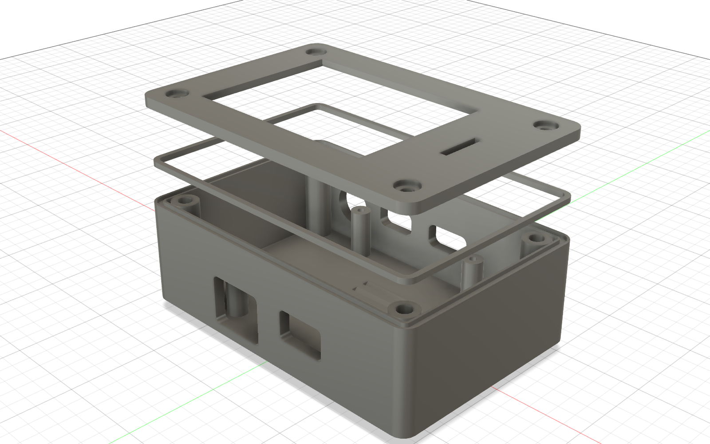

# Assembly guide

Exploded view: [`images/02-exploded-view.png`](images/02-exploded-view.png).

## Hardware

- 4x M3 heat-set inserts, 5 mm
- 4x M3 x 8 pan-head screws
- 4x M2.5 x 6 self-tapping screws
- 1x panel switch (12 mm hole)
- 1x clear pane, 1 mm thick, 62 x 47.5 mm

## Steps

1. **Inserts.** Heat-set the four M3 inserts into the corner bosses of the base tray (iron at 220-240 C).
2. **Heat sink.** Fit the heat sink to the Orange Pi Zero 3.
3. **Board.** Turn the board over so the heat sink faces the rear wall. Fasten it to the four standoffs with the M2.5 x 6 screws. The heat sink sits over the vent slots.
4. **Switch.** Fit the panel switch into the 12 mm hole in the +Y wall and connect its wires to the board.
5. **Gasket.** Press the TPU gasket into the groove on the tray rim.
6. **Pane.** Lay the clear pane into the recess on the underside of the lid.
7. **Display and reader.** Place the LCD module against the pane with the display facing the window, and fit the card reader to the slot on the right of the lid.
8. **Close.** Place the lid on the tray and fasten the four M3 x 8 screws evenly in a cross pattern until the gasket is lightly compressed.

## Port layout (lid on top)

| Wall | Openings |
|---|---|
| +Y | USB-C power, HDMI, panel switch, reset pin |
| -Y | RJ45, USB-A |

## Use

- Press the reset pin through the 2.5 mm hole with a pin or a printed plunger.
- For outdoor use, mount the unit with the rear vents facing down or away from rain, and cap unused port openings.
- To service the board, remove the four lid screws and lift the lid; the gasket stays in the groove.
