# 23RU Outdoor Telecom Cabinet

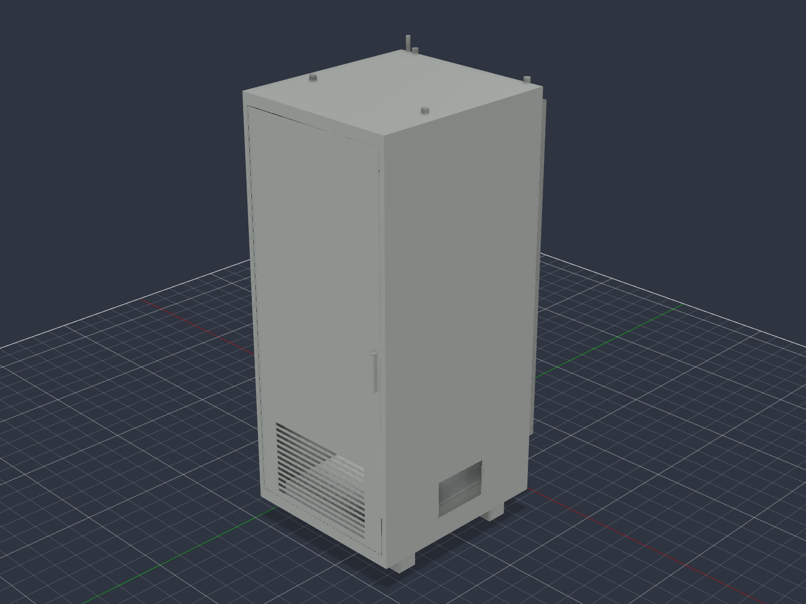

A fully modelled, dimensioned and documented **outdoor telecom cabinet with a 23RU, 19-inch open rack**, designed in Autodesk Fusion. It combines a 1.5 mm sheet-steel shell, a hinged front door with an intake louvre, a rear filter housing, a sloped cable-entry mudroom and a monopole side access port in a compact 761 x 843 mm footprint.

**Designer:** Oluwatimileyin Oluleye, CAD Designer
**Software:** Autodesk Fusion
**Drawing set:** OTC-23RU-001 to 004, Rev A

## Design at a glance

| Parameter | Value |
|---|---|
| Rack capacity | 23RU, 19-inch (EIA-310), 1022.35 mm mounting height |
| Cabinet shell (W x D x H) | 761 x 842.9 x 1778 mm |
| Overall (W x D x H, incl. handle and mast) | 761 x 985.2 x 1933 mm |
| Construction | 1.5 mm galvanised sheet steel (SGCC) |
| Finish | Polyester powder coat, RAL 7035 light grey |
| Calculated mass, empty | 154.4 kg |
| Mounting | 4 feet, 4 x M12 holes on a 600 x 540 mm pattern |
| Cable entry | Sloped mudroom and monopole side port, 255.6 x 165 mm |
| Environmental design targets | -35 to +51.7 C, IP55, 65 dB(A) max, 95 % RH non-condensing |
| General tolerances | ISO 2768-m; welds to ISO 5817 level C |

## Key features

- **Hinged front door** (705 x 1672 mm, left-hand hinge) with a 13-slot intake louvre and handle, and a 3 mm gap all round.
- **23RU open rack:** four L-section rails with the EIA-310 hole pattern (69 holes per rail) and top and base support frames tied to the side walls.
- **Rear filter housing,** 600 x 1491.6 x 122.3 mm.
- **Sloped mudroom** (600 x 700 mm) whose top rises from Z = 165 at the front to Z = 190.5 at the rear.
- **Monopole side access port** through the right wall.
- **Four-foot base** with M12 mounting holes.
- **Four lifting eyes** and a **GPS antenna mast** on the roof.

## 3D design gallery

### Door closed

| Front-right | Front-left |
|---|---|
|  | 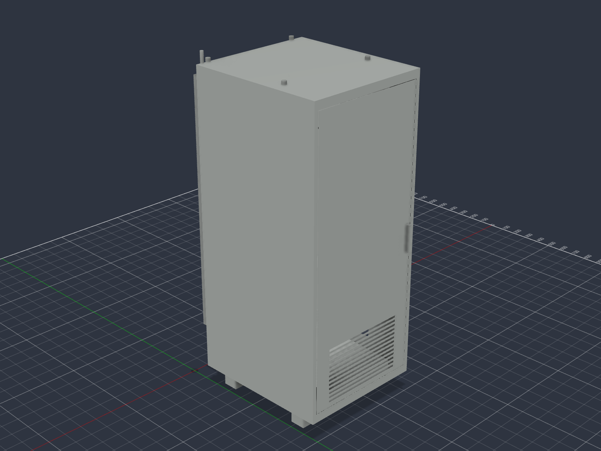 |
| **Rear-right** | **Rear-left** |
| 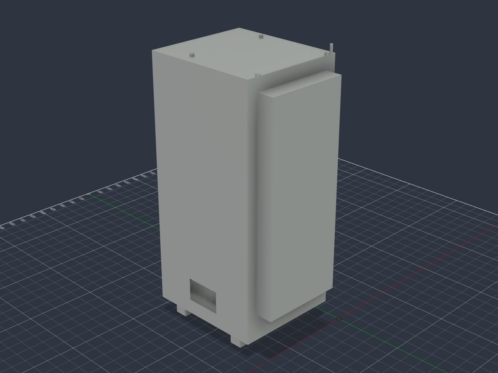 | 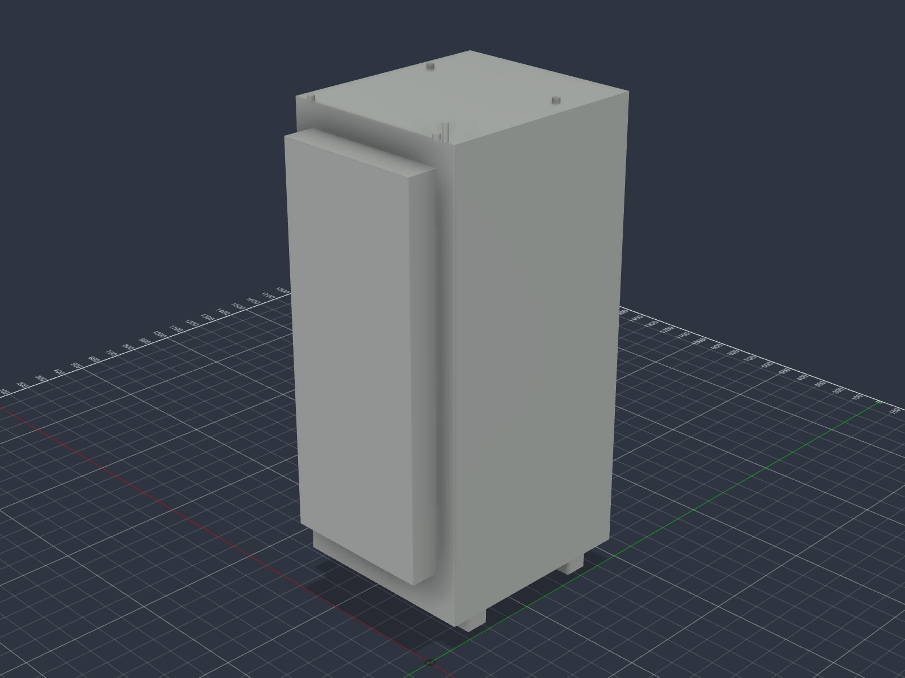 |
| **High angle** | **Low angle** |
| 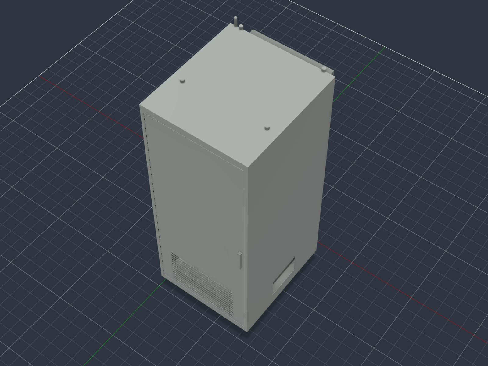 | 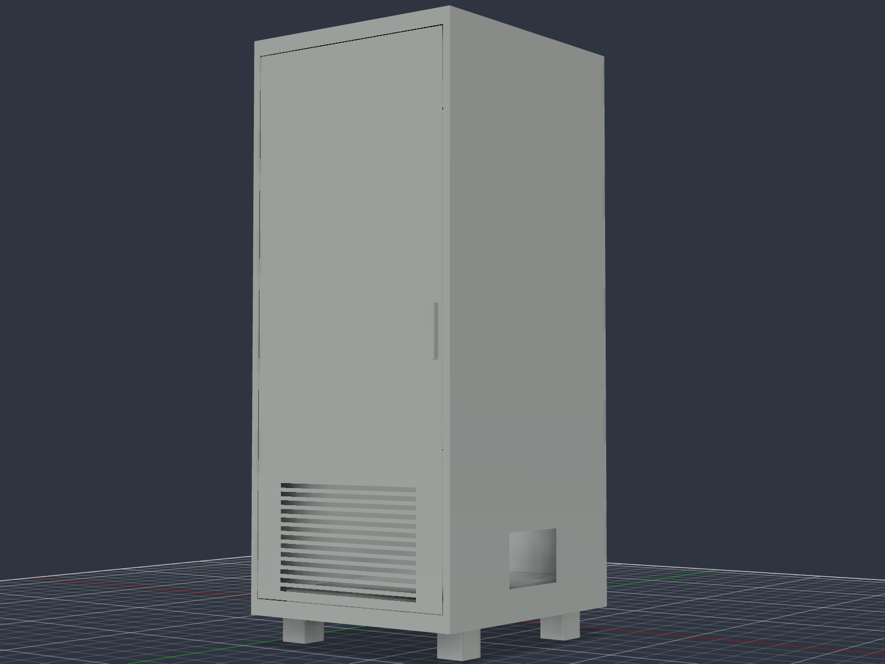 |

### Door open (90 degrees)

| Front-right | Front-left |
|---|---|
| 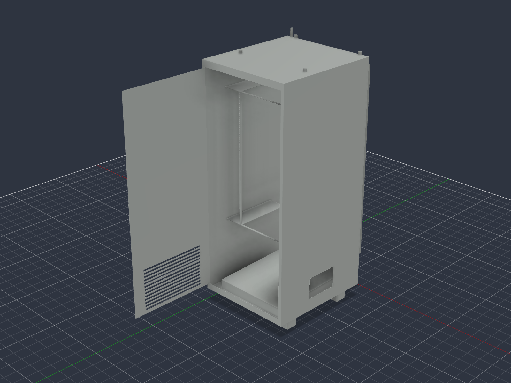 | 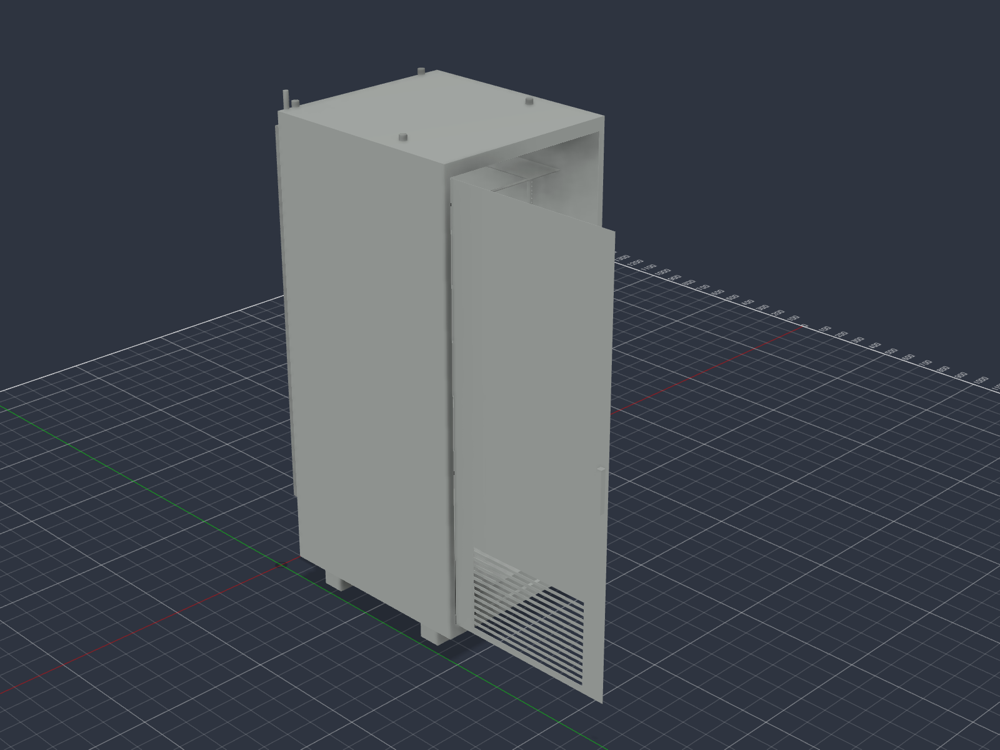 |
| **High angle** | **Low angle** |
| 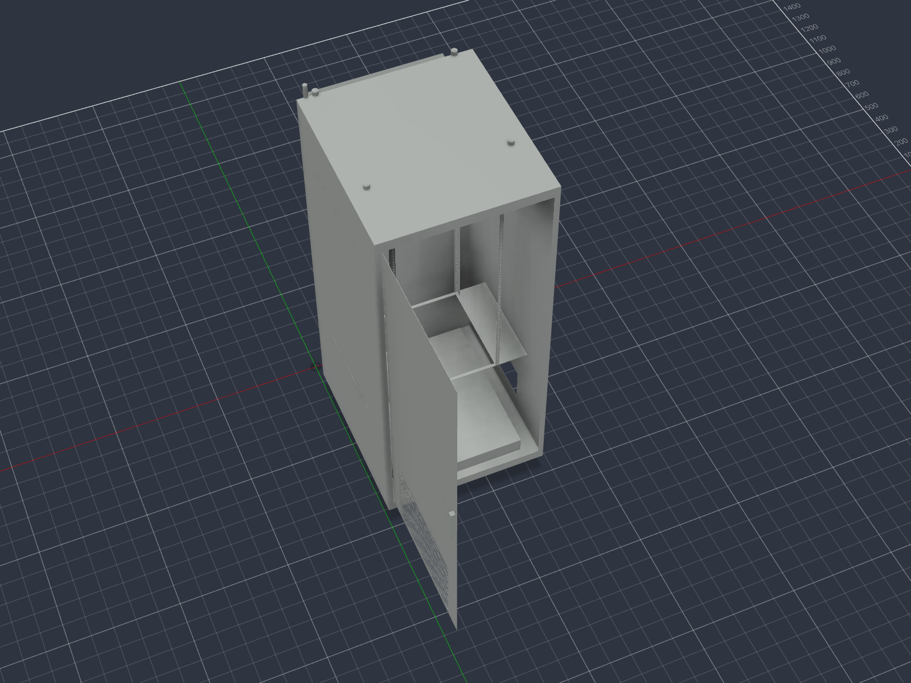 | 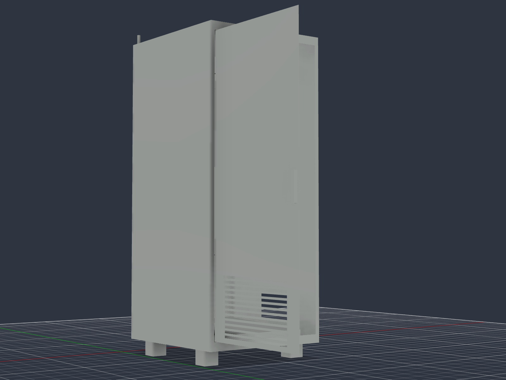 |

### Orthographic views

| Front | Right side | Top |
|---|---|---|
| 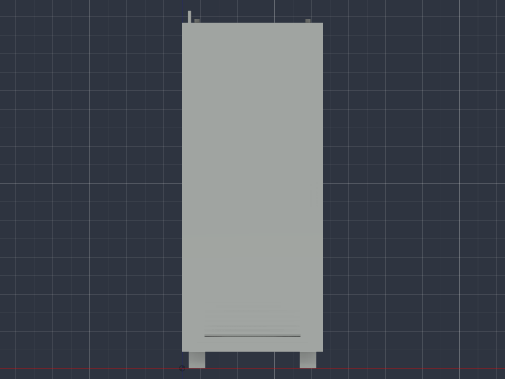 | 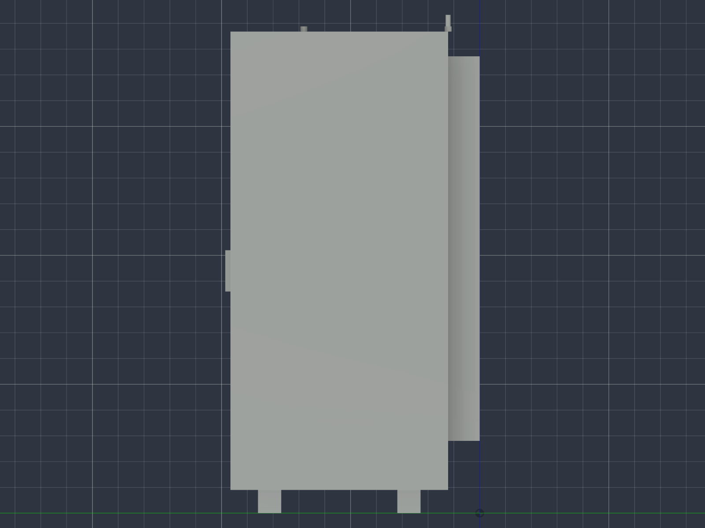 | 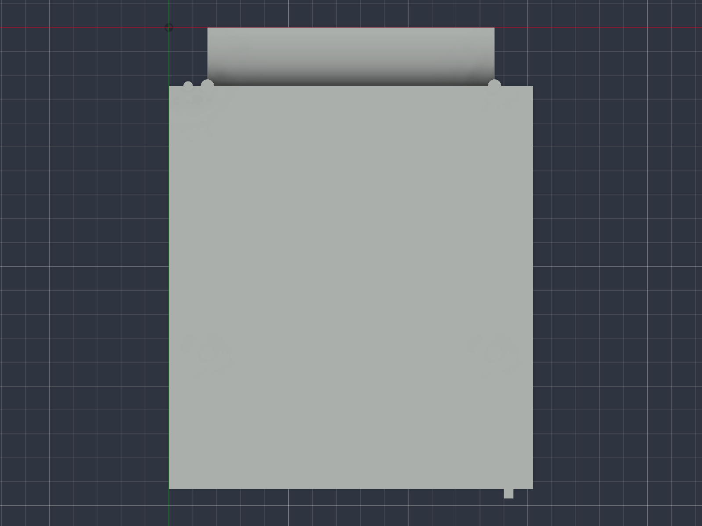 |

## Technical drawings

Four A2 sheets, third-angle projection, millimetres, with title block, general notes, sections, details, bill of materials, tolerances, bend and weld schedules and fabrication notes:

- [OTC-23RU-001: General arrangement, 1:10](docs/drawings/OTC-23RU-001_general-arrangement.svg)
- [OTC-23RU-002: Interior arrangement, rack, mudroom and side port](docs/drawings/OTC-23RU-002_interior-arrangement.svg)
- [OTC-23RU-003: Door, base and roof details](docs/drawings/OTC-23RU-003_door-base-and-roof.svg)
- [OTC-23RU-004: Bill of materials, tolerances and fabrication data](docs/drawings/OTC-23RU-004_bom-tolerances-fabrication.svg)
- [Complete drawing set (PDF)](docs/drawings/OTC-23RU_drawing-set.pdf)

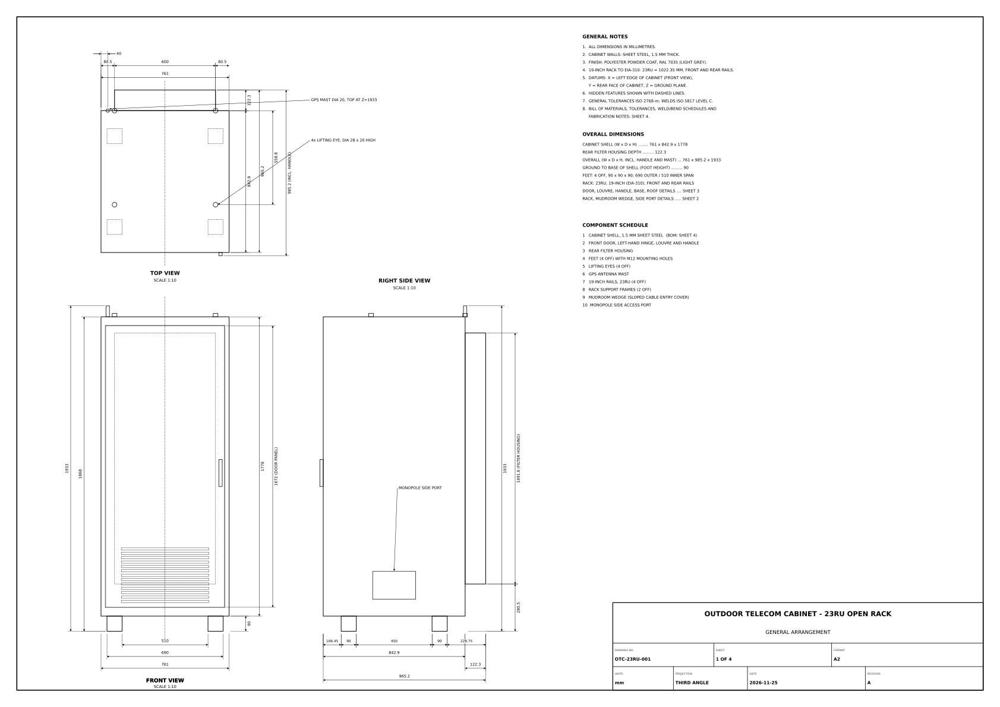

## Parts list

| Item | Description | Qty | Material |
|---|---|---|---|
| 1 | Cabinet shell, 761 x 842.9 x 1778 mm | 1 | Galvanised sheet steel (SGCC) 1.5 mm |
| 2 | Front door panel, 705 x 1672 mm | 1 | Galvanised sheet steel (SGCC) 1.5 mm |
| 3 | Rear filter housing, 600 x 122.3 x 1491.6 mm | 1 | Galvanised sheet steel (SGCC) 1.5 mm |
| 4 | Foot block, 90 x 90 x 90 mm | 4 | Carbon steel |
| 5 | Door handle, 20 x 160 mm | 1 | Steel |
| 6 | Lifting eye, dia 28 x 20 mm | 4 | Steel |
| 7 | GPS antenna mast, dia 20 mm | 1 | Steel |
| 8 | 19-inch rail, L-section, 1022.35 mm | 4 | Galvanised sheet steel (SGCC) 3 mm |
| 9 | Rack support frame, 758 x 463 mm | 2 | Steel plate 3 mm |
| 10 | Mudroom, 600 x 700 mm | 1 | Galvanised sheet steel (SGCC) 1.5 mm |

## Verification

- The Fusion model rebuilds with all 60 timeline items healthy.
- Overall envelope measured from the model: 761.0 x 985.2 x 1933.0 mm, matching drawing OTC-23RU-001.
- Door-to-cabinet clearance measured at 3.000 mm.
- Mass calculated from model volume at 7.85 g/cm3: 154.4 kg empty.

Results are listed in [`data/design_checks.csv`](data/design_checks.csv).

## CAD files

| File | Format |
|---|---|
| [`cad/outdoor-telecom-cabinet-23ru.step`](cad/outdoor-telecom-cabinet-23ru.step) | STEP, opens in any CAD, CAM or fabrication software |
| [`cad/outdoor-telecom-cabinet-23ru.stl`](cad/outdoor-telecom-cabinet-23ru.stl) | STL mesh |
| [`cad/outdoor-telecom-cabinet-23ru.f3d`](cad/outdoor-telecom-cabinet-23ru.f3d) | Autodesk Fusion design with full feature history |

See [`docs/SPECIFICATION.md`](docs/SPECIFICATION.md) for the complete specification and [`START-HERE.md`](START-HERE.md) for the one-page guide.
