# Modern Minimalist Stainless Steel Dining Set

**Drawing No. SDS-100** | Dining table SDS-T160 + 4 dining chairs SDS-C45 | Designed in Autodesk Fusion

A complete dining set for an indoor home dining area: a slim-topped table on tapered stainless steel legs and four open wire-frame chairs with upholstered seat pads. The metalwork is AISI 304 stainless steel in a satin warm-taupe PVD finish; the table top is a light-grey honed sintered stone slab. Every part is modelled to manufacturing dimensions and delivered as F3D, STEP, STL and a dimensioned drawing set.

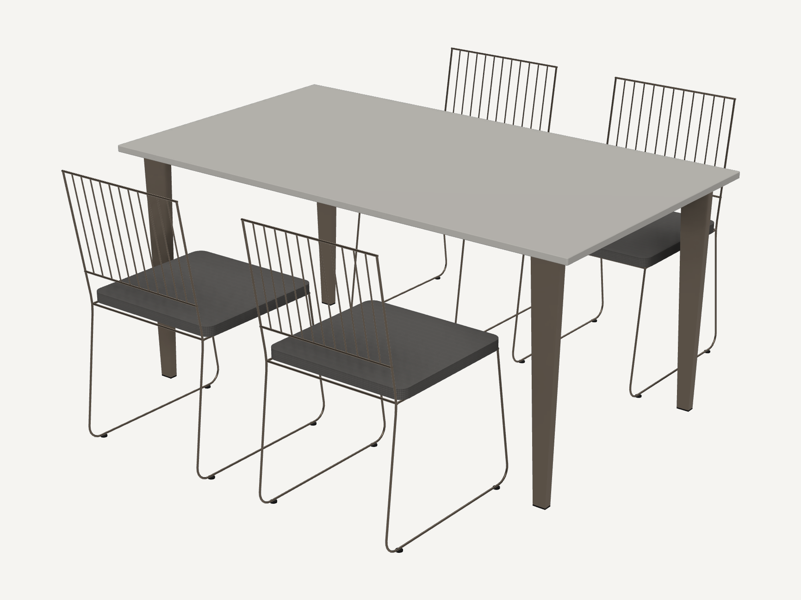

## Design Brief

Modern and minimalist, functional yet aesthetically pleasing, in stainless steel, suited to indoor home dining, with good dining ergonomics.

## Highlights

- Clean, light visual language: thin top, tapered blade legs, open wire-frame chairs
- Stainless steel AISI 304 frame throughout, satin brushed with warm-taupe PVD
- Dining ergonomics: 750 mm table height, 450 mm seat height, 300 mm seat-to-table clearance
- Chairs tuck under the table; 10 degree back rake with 11 vertical slats
- Fully modelled assembly with part numbers and bill of materials
- Manufacturing-ready exports: F3D, STEP, STL (mm) and a 3-sheet technical drawing

## Views

| | |
|---|---|
|  | 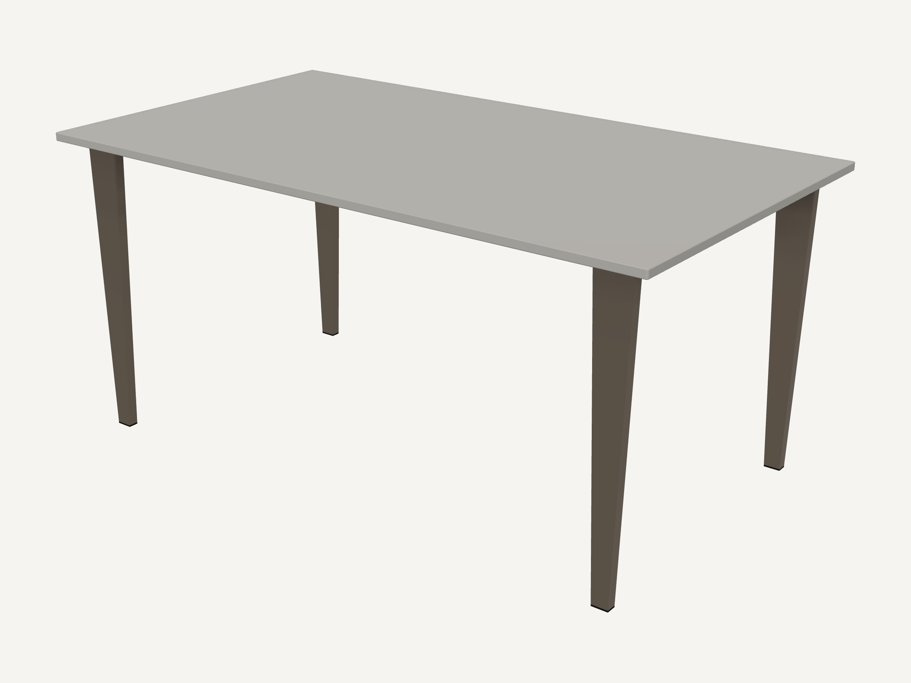 |
| 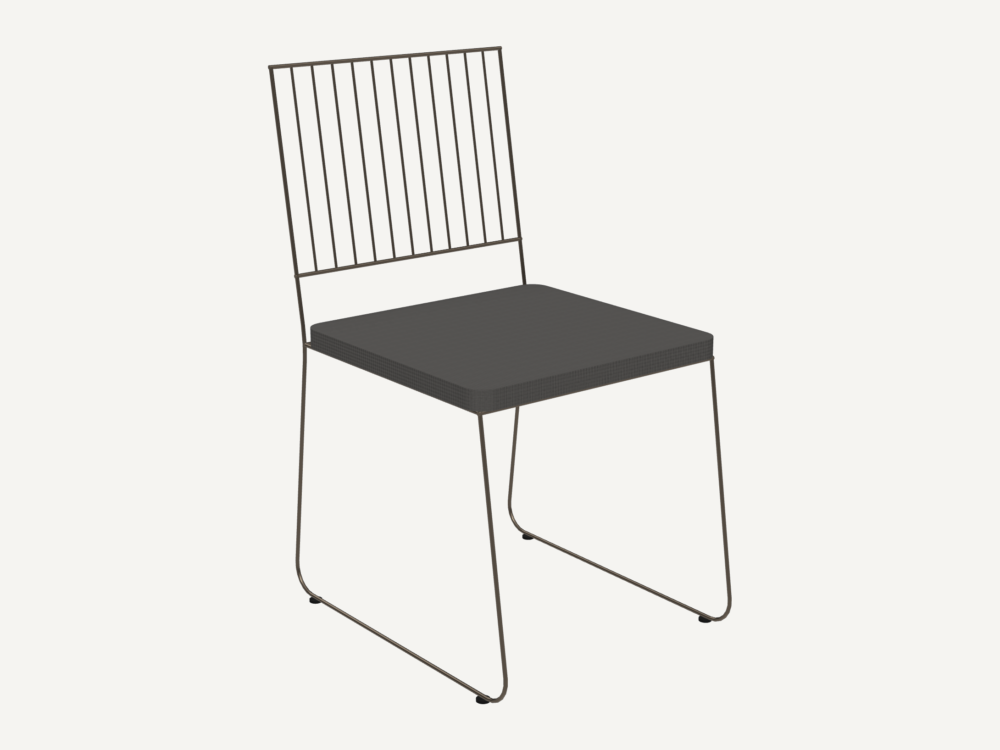 | 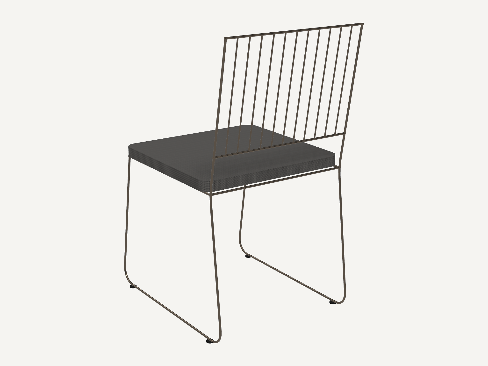 |
| 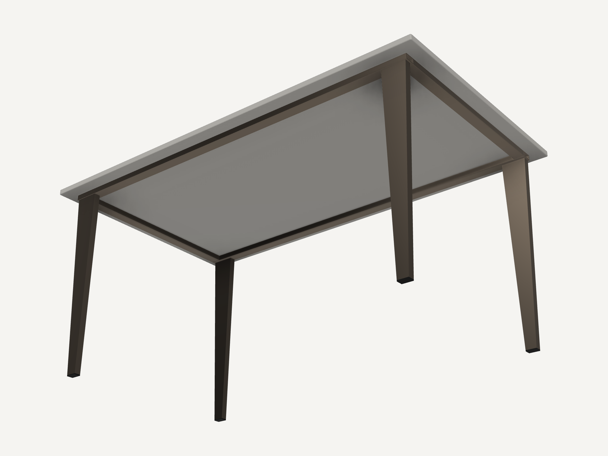 | 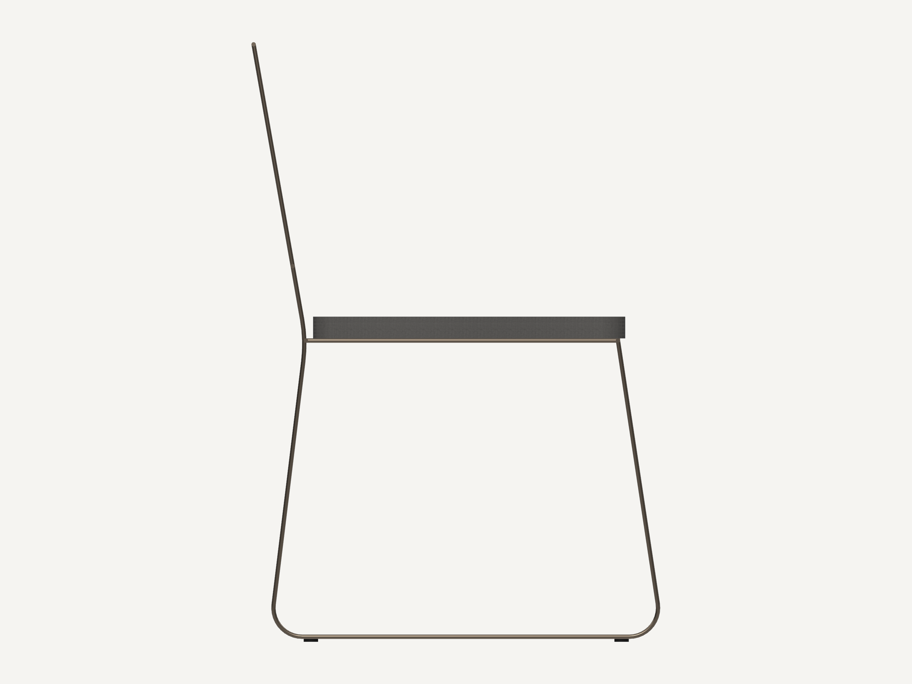 |

### Orthographic views

| Front elevation | Side elevation |
|---|---|
| 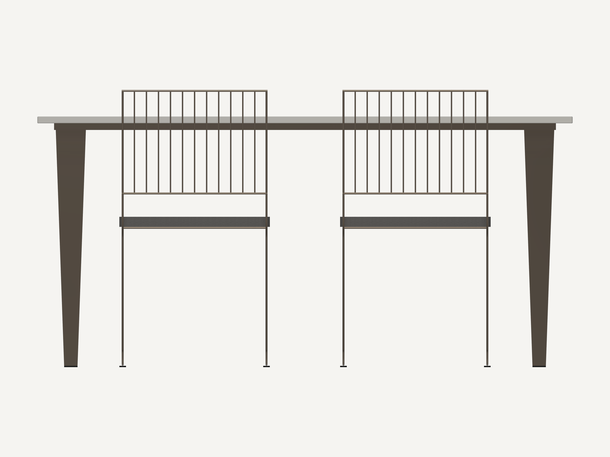 | 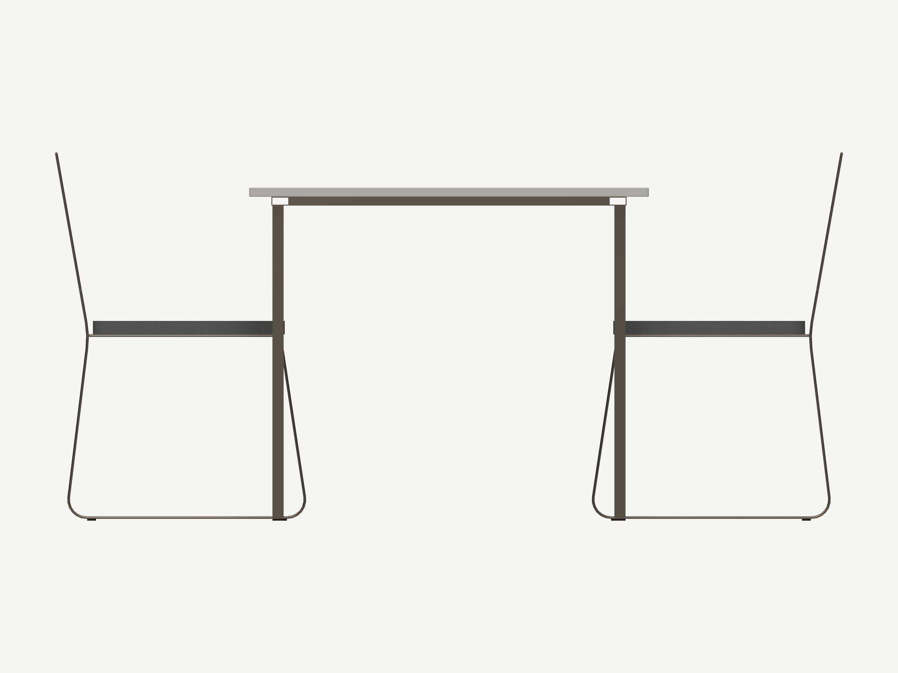 |

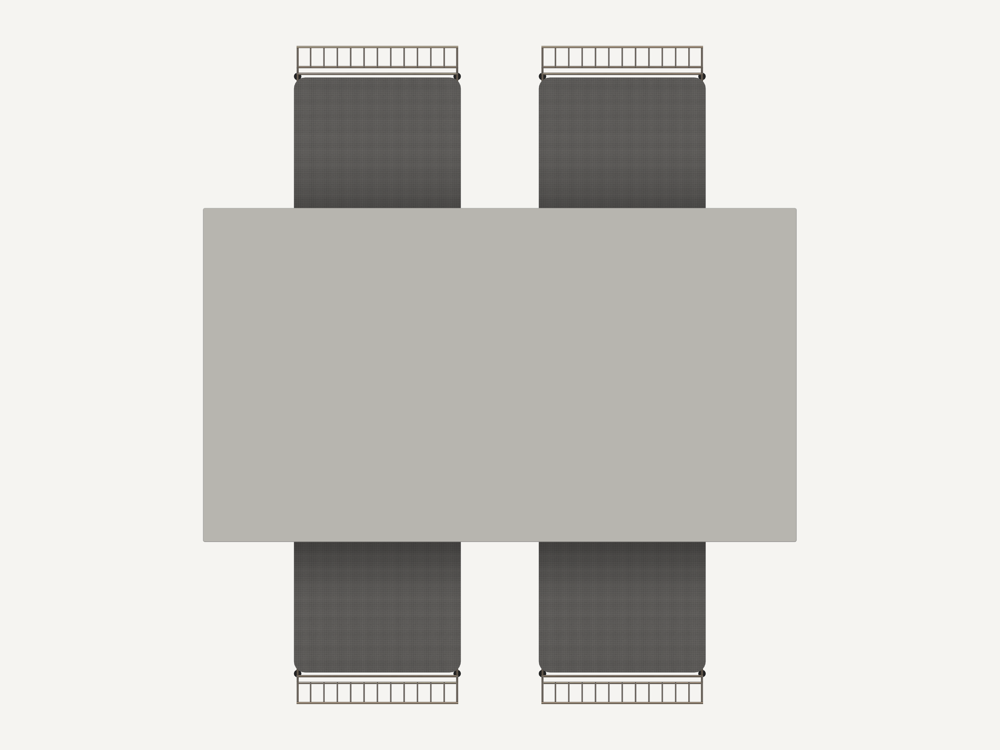

## Specification

### Dining table SDS-T160

| Item | Specification |
|---|---|
| Overall size | 1600 x 900 x 750 mm (L x W x H) |
| Top | 1600 x 900 x 20 mm sintered stone, honed matte, light grey; corner radius R5, edge arris 1.5 x 45 deg |
| Sub-frame | AISI 304 rectangular tube 40 x 20 x 2 mm, outer frame 1500 x 800 mm, top bonded with structural MS-polymer adhesive |
| Legs | 4 x tapered blade, 90 x 25 mm head to 40 x 25 mm foot, 2 mm wall, height 706 mm |
| Leg centres | x = +/-700 mm, y = +/-385 mm |
| Feet | Nylon 6 glides, 40 x 25 x 4 mm |
| Metal finish | Satin brushed, PVD warm taupe |
| Mass | approx. 91 kg |

### Dining chair SDS-C45

| Item | Specification |
|---|---|
| Overall size | 450 x 566 x 830 mm (W x D x H) |
| Seat height | 450 mm |
| Seat pad | 450 x 432 x 30 mm, HR polyurethane foam on rigid base, grey woven polyester cover, R30 corners |
| Frame | AISI 304 rod: dia 6 mm seat rails, side frames and back rails; 11 vertical slats dia 4 mm at 36 mm pitch |
| Back | 830 mm overall height, 10 degree rake, lower rail at 520 mm |
| Side frame | Continuous sled-base rod with R40 floor bends and R200 back-rake transition |
| Feet | 4 x nylon 6 glides, dia 20 x 4 mm |
| Metal finish | Satin brushed, PVD warm taupe |
| Mass | approx. 1.9 kg |

### Set layout

| Item | Value |
|---|---|
| Configuration | 1 table + 4 chairs, two chairs per long side |
| Footprint | 1600 x 1775 mm |
| Seat-to-table clearance | 300 mm |
| Total mass | approx. 98 kg |

## Materials and Finishes

| Component | Material | Finish |
|---|---|---|
| Table top | Sintered stone, 20 mm | Honed matte, light grey |
| Sub-frame, legs, chair frame | Stainless steel AISI 304 (EN 1.4301) | Satin brushed, PVD warm taupe |
| Seat pad | HR PU foam, woven polyester cover | Grey |
| Glides | Nylon 6 | Black |

## Bill of Materials

| Item | Part No. | Description | Qty | Material |
|---|---|---|---|---|
| 1 | SDS-T-01 | Table top 1600 x 900 x 20 | 1 | Sintered stone |
| 2 | SDS-T-02 | Sub-frame tube 40 x 20 x 2, L1500 | 2 | AISI 304 |
| 3 | SDS-T-03 | Sub-frame tube 40 x 20 x 2, L720 | 2 | AISI 304 |
| 4 | SDS-T-04 | Tapered leg, 2 mm wall, H706 | 4 | AISI 304 |
| 5 | SDS-T-05 | Leg glide 40 x 25 x 4 | 4 | Nylon 6 |
| 6 | SDS-C-01 | Chair frame, welded rod (dia 6 / dia 4) | 4 | AISI 304 |
| 7 | SDS-C-02 | Seat pad 450 x 432 x 30 | 4 | HR PU foam, polyester cover |
| 8 | SDS-C-03 | Chair glide dia 20 x 4 | 16 | Nylon 6 |

## Manufacturing Notes

- **Table sub-frame:** cut rectangular tube to length, TIG weld the rectangle, dress welds, then bond the stone top.
- **Legs:** laser-cut 2 mm AISI 304 sheet, fold to the tapered section, TIG seam weld, dress and weld the head to the sub-frame corner.
- **Chair frame:** bend the dia 6 side frames (R40 floor bends, R200 back transition), cut and weld seat rails, back rails and the 11 dia 4 slats; dress all welds.
- **Finishing:** satin brush all metal parts, then PVD warm taupe.
- **Assembly:** fit glides, secure seat pads to the seat frame, bond the table top.
- General tolerances ISO 2768-m. Break all sharp edges.

## Project Contents

```
stainless-steel-dining-set/
|-- START-HERE.md
|-- README.md
|-- CHANGELOG.md
|-- cad/
|   |-- SDS-100_Dining_Set.f3d             Editable Fusion model
|   |-- SDS-100_Dining_Set.step            Full assembly
|   |-- SDS-T160_Dining_Table.step
|   |-- SDS-C45_Dining_Chair.step
|   |-- SDS-100_Dining_Set.stl             Millimetre units, binary
|   |-- SDS-T160_Dining_Table.stl
|   `-- SDS-C45_Dining_Chair.stl
|-- data/
|   |-- parameters.csv                     Key dimensions
|   `-- bom.csv                            Bill of materials
`-- docs/
    |-- drawings/                          3-sheet technical drawing (PDF + PNG)
    `-- images/                            3D views of the design
```

## Technical Drawing

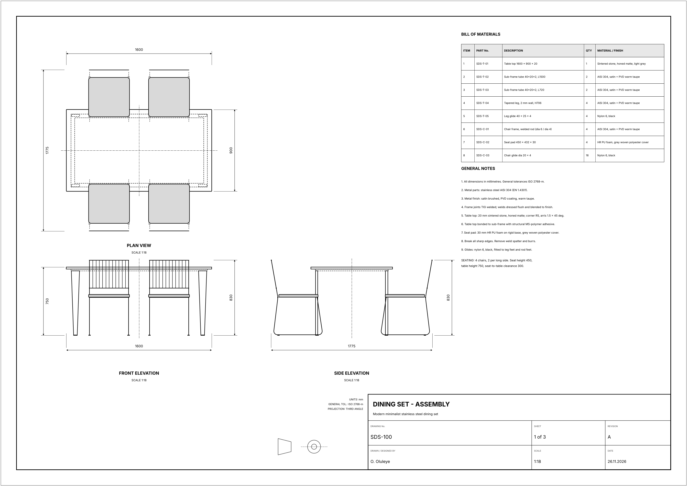

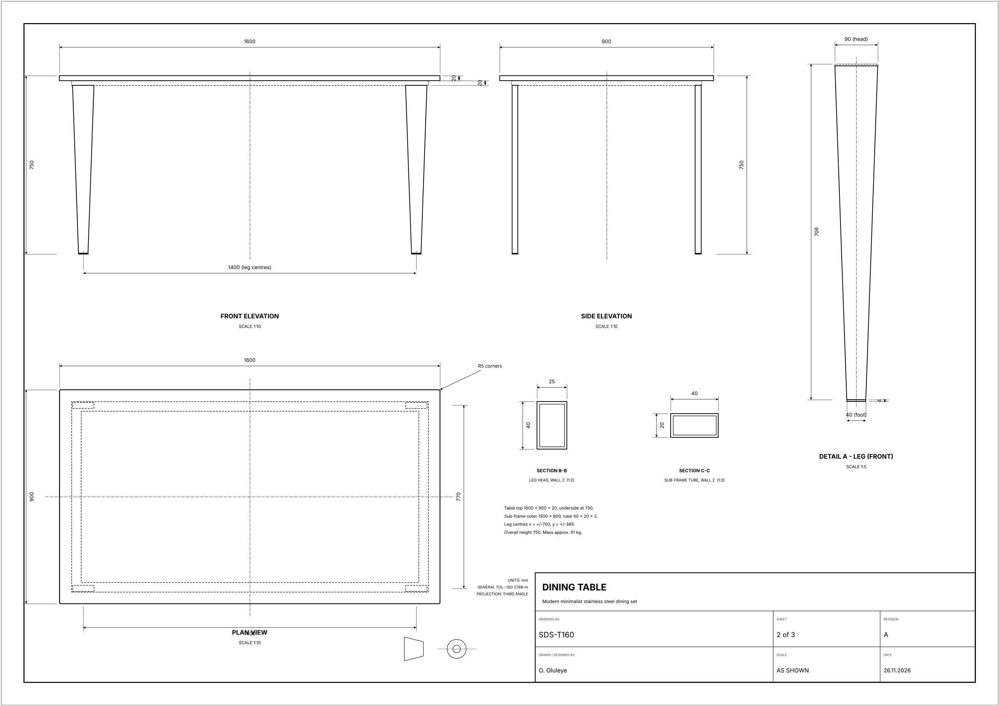

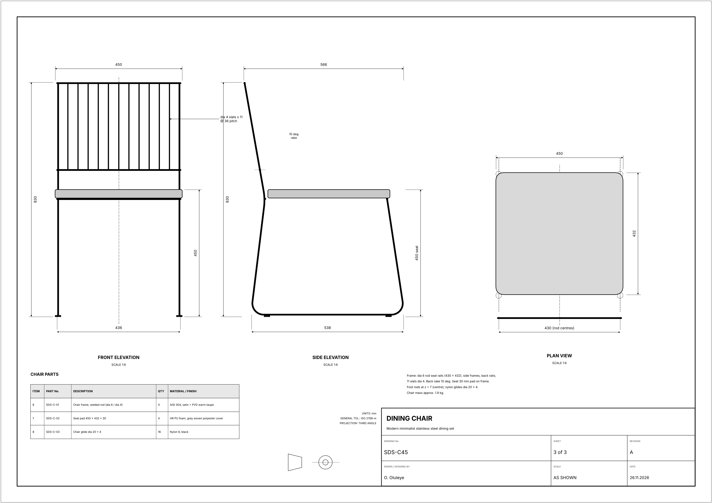

Full set: [SDS-100_Technical_Drawing.pdf](docs/drawings/SDS-100_Technical_Drawing.pdf)

## Software

Autodesk Fusion (parametric modelling, F3D, STEP and STL export).

## Designer

**Oluwatimileyin Oluleye** - CAD Designer
[LinkedIn](https://www.linkedin.com/in/oluwatimileyinoluleye) | oluwatimileyinoluleye@gmail.com
