# 22U Pyramid-Canopy Outdoor Street Cabinet

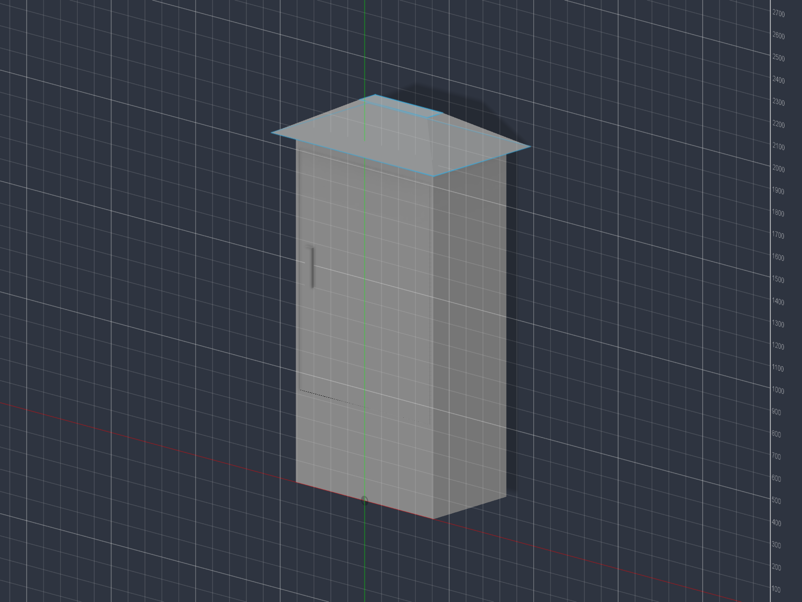

A fully modelled, dimensioned and documented **22U outdoor street cabinet** for fibre-optic distribution (FTTx), designed in Autodesk Fusion. It combines a weather-shedding pyramid canopy, a front equipment door, an internally locked side door, a cable-management base chamber and a 22U rack frame in a compact 814 x 462 mm footprint.

**Designer:** Oluwatimileyin Oluleye, CAD Designer
**Software:** Autodesk Fusion
**Drawing set:** SC22U-GA-001 and 002, Rev A

## Design at a glance

| Parameter | Value |
|---|---|
| Rack capacity | 22U (977.9 mm mounting height) |
| Overall size (H x W x D) | 1728 x 814 x 462 mm |
| Canopy footprint | 960 x 608 mm, 150 mm high |
| Body height | 1578 mm |
| Body construction | 2 mm steel sheet |
| Finish | Electrostatic outdoor powder coat, RAL 7035 light grey |
| Ingress protection | IP56 |
| Feeder cable entries | 4 |
| Secondary cable entries | 48 |
| Operating temperature | -30 C to +65 C |
| Design weight | 180 kg empty, 230 kg equipped |

## Key features

- **Pyramid canopy** sheds rain and dust quickly and carries a natural ventilation path above the equipment area.
- **Front lockable door** (770 x 1082 mm) with full access to the 22U rack space.
- **Side door with internal lock** (367 x 1082 mm), secured from inside the cabinet and ready for a smart lock.
- **Built-in base chamber** (420 mm) for slack incoming cable.
- **Cable entry at the base:** 4 feeder entries (Dia 60) and 48 secondary entries (Dia 16).
- **22U rack frame** with four 30 x 30 mm posts and an equipment floor plate with a 300 x 60 mm cable pass-through.

## 3D design gallery

### Doors closed

| Front-right | Front-left |
|---|---|
|  | 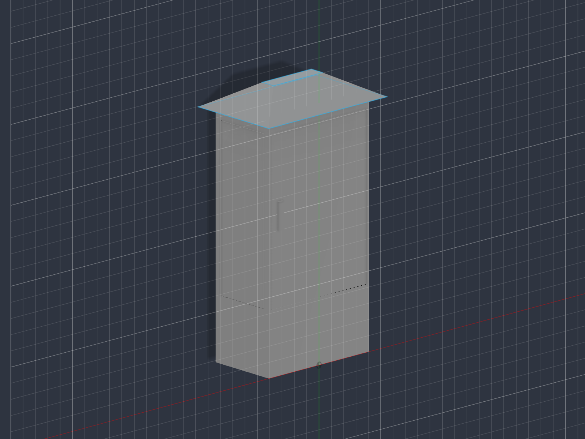 |
| **Rear-right** | **Rear-left** |
| 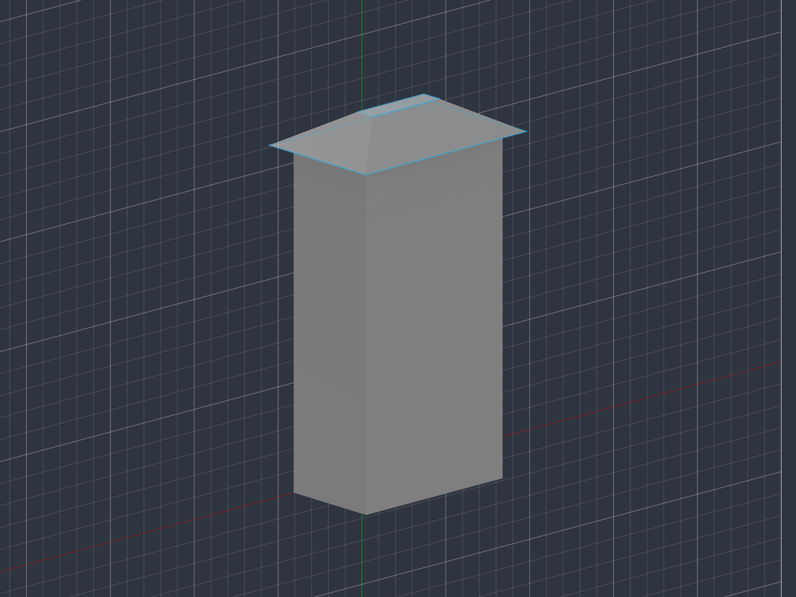 | 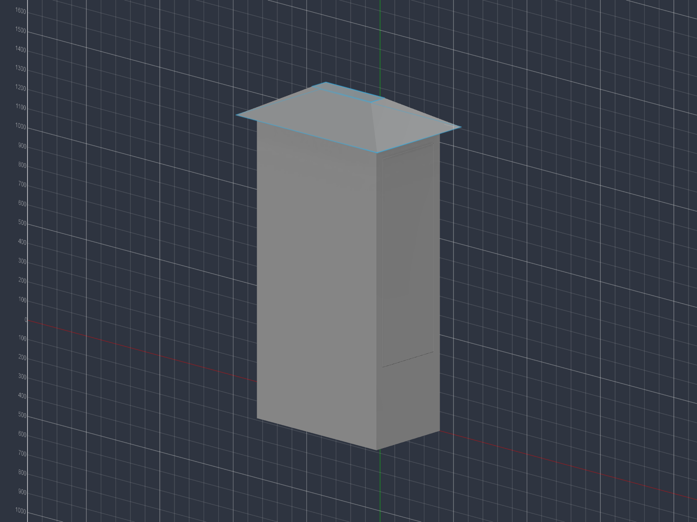 |
| **High angle** | **Low angle** |
| 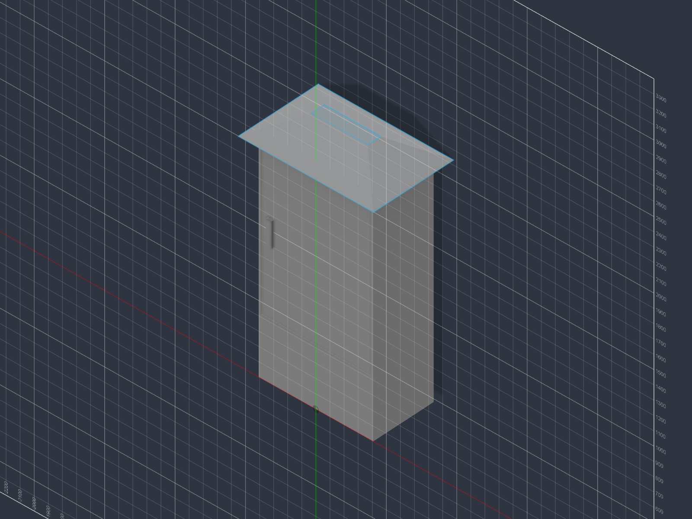 | 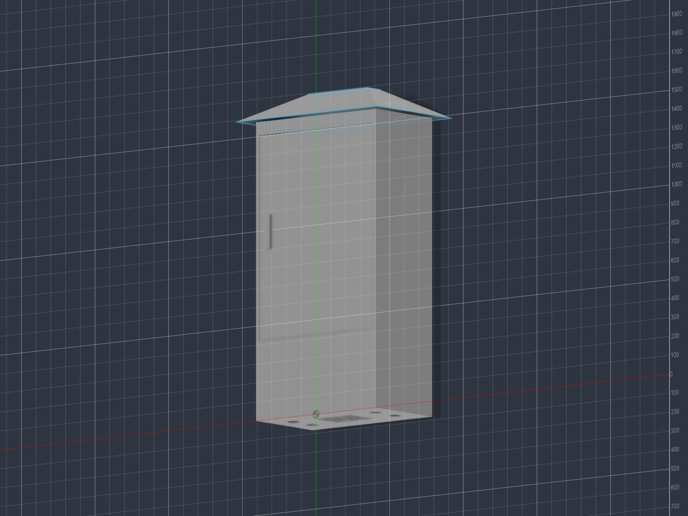 |

### Doors open

| Front-right | Front-left |
|---|---|
| 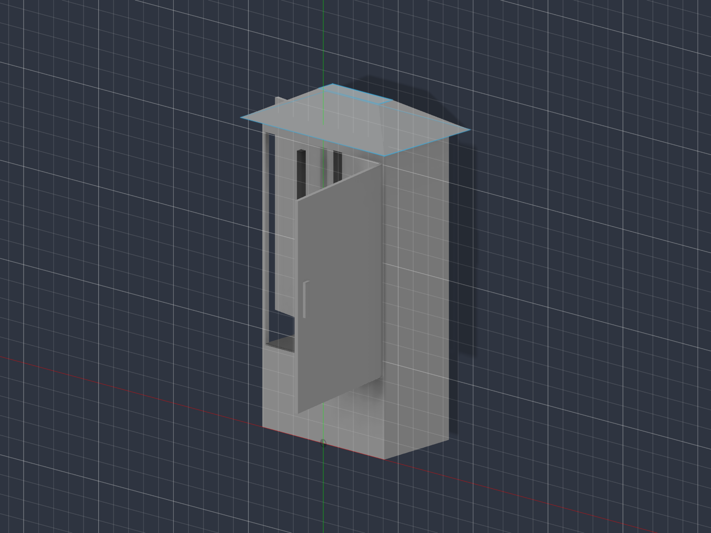 | 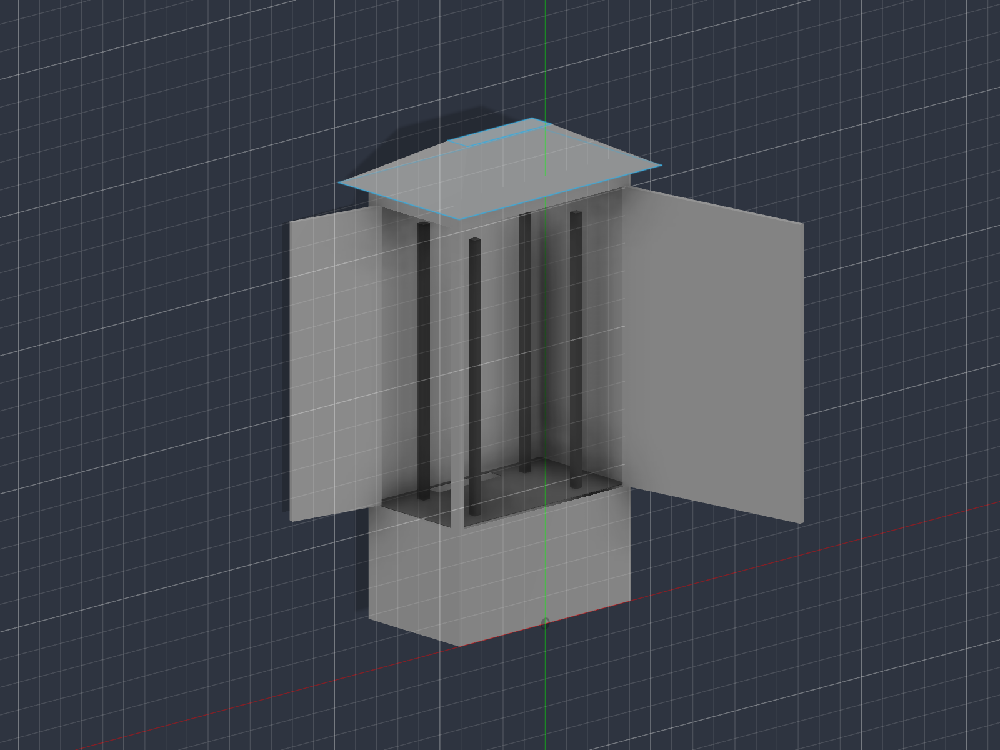 |
| **High angle** | **Low angle** |
| 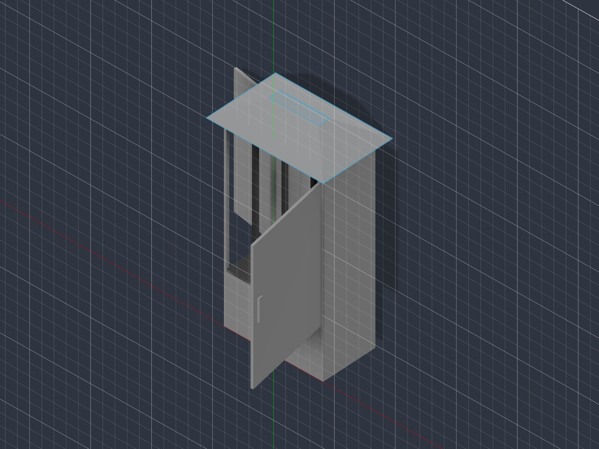 | 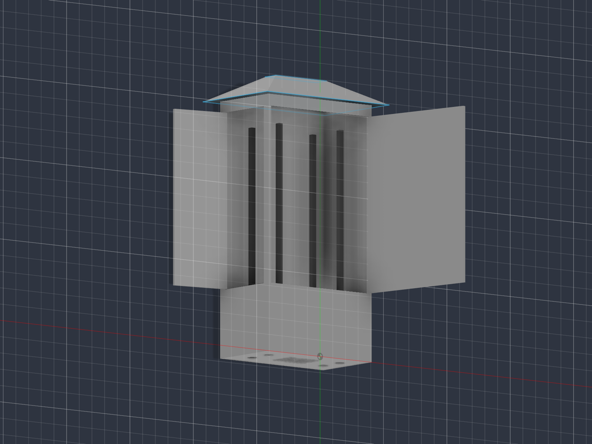 |

### Orthographic views

| Front | Left side | Top |
|---|---|---|
| 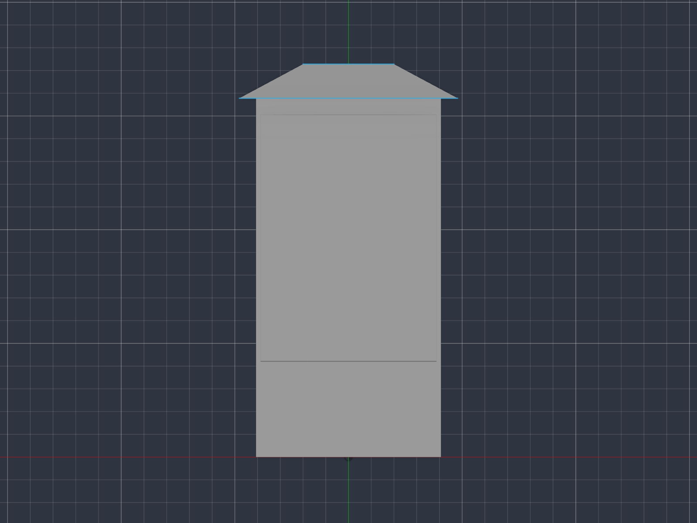 | 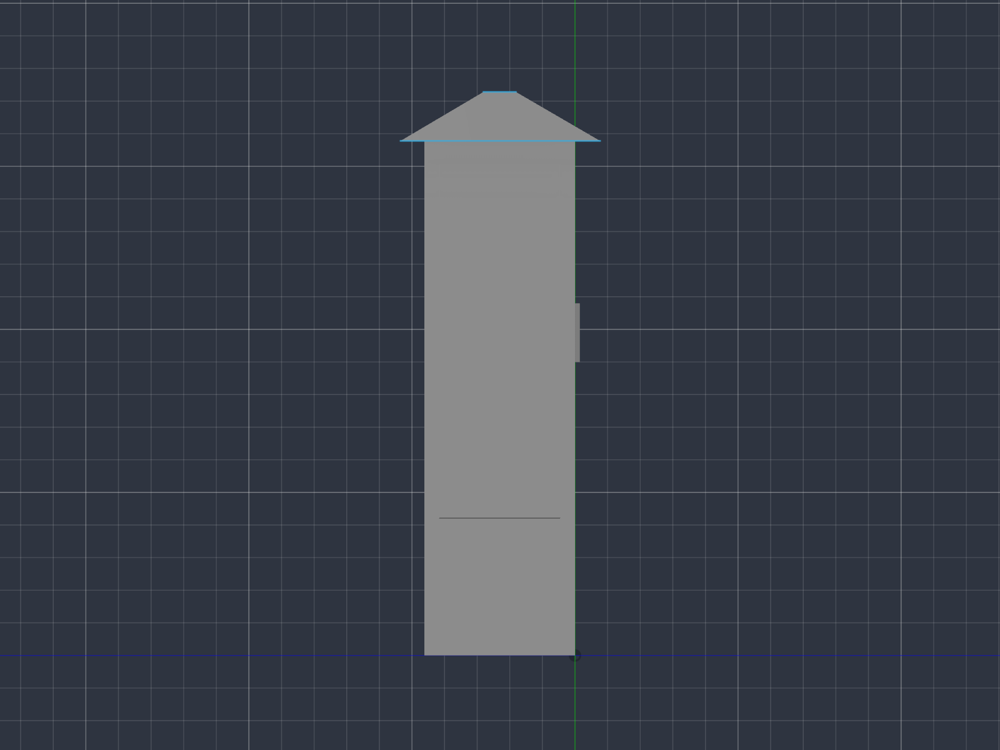 | 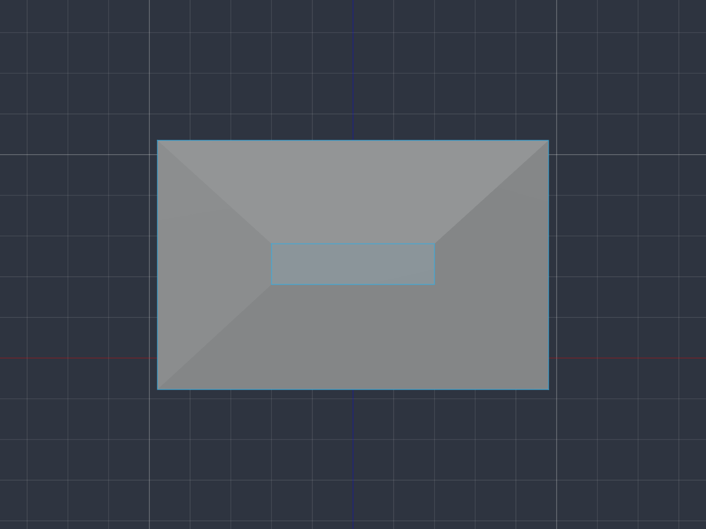 |

## Technical drawings

Dimensioned drawings with title block, general notes and parts list (A3, SVG):

- [SC22U-GA-001: General arrangement, 1:10](docs/drawings/SC22U-GA-001_general-arrangement.svg)
- [SC22U-GA-002: Cable entries, equipment floor, rack posts, door panels and parts list, 1:5 and 1:10](docs/drawings/SC22U-GA-002_details-and-parts-list.svg)

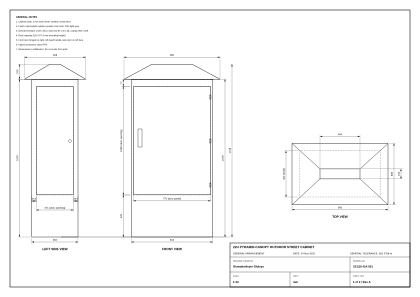

## Parts list

| Item | Description | Qty | Material |
|---|---|---|---|
| 1 | Cabinet body shell, 814 x 462 x 1578 mm | 1 | Steel sheet 2 mm |
| 2 | Front door panel, 770 x 1082 x 20 mm | 1 | Steel sheet |
| 3 | Side door panel, 367 x 1082 x 20 mm | 1 | Steel sheet |
| 4 | Pyramid canopy, 960 x 608 x 150 mm | 1 | Steel sheet 2 mm |
| 5 | Rack post, 30 x 30 x 998 mm | 4 | Steel |
| 6 | Equipment floor plate, 2 mm | 1 | Steel sheet 2 mm |

## CAD files

| File | Format |
|---|---|
| [`cad/street-cabinet-22u.step`](cad/street-cabinet-22u.step) | STEP, opens in any CAD, CAM or fabrication software |
| [`cad/street-cabinet-22u.f3d`](cad/street-cabinet-22u.f3d) | Autodesk Fusion design with full feature history |

The model is parametric and organised into five components: Cabinet Body, Front Door, Side Door, Rack Frame and Pyramid Canopy.

See [`docs/SPECIFICATION.md`](docs/SPECIFICATION.md) for the complete specification and [`START-HERE.md`](START-HERE.md) for the one-page guide.
