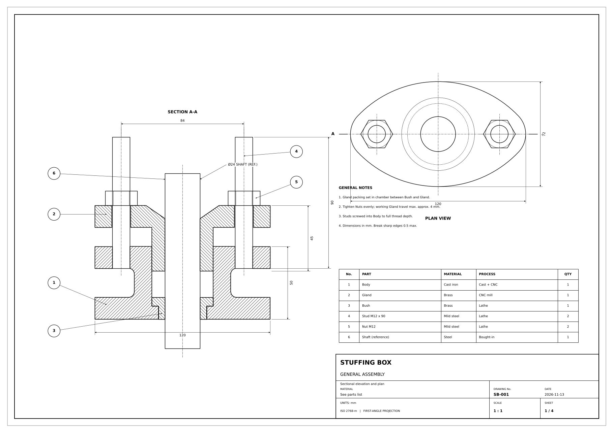

# Stuffing Box

A six-part stuffing box assembly (cast-iron body, adjustable brass gland, brass bush, studs, nuts and shaft) designed in Autodesk Fusion, with full ISO technical drawings, material specification, design verification, kinematic study and CNC machining plan.



## What it is

A stuffing box seals a rotating shaft where it passes through a housing. Packing is compressed in the annular chamber between the bush and the gland by tightening two nuts on studs, which drives the gland down its slide. This design is based on the classic textbook layout (Fig. 18.1 / 18.1A) and is fully dimensioned and specified for manufacture.

## Key specifications

| Item | Value |
|---|---|
| Shaft diameter | 24 mm |
| Packing chamber | Ø42 mm bore, 41 mm deep, packing annulus 933 mm² |
| Flange envelope | 120 x 72 mm (R18 ends, R76 tangent sides), stud centres 84 mm |
| Body height | 50 mm (15 mm base flange, Ø66 neck, 15 mm top flange) |
| Fasteners | 2 x M12 x 90 studs, 2 x M12 hex nuts (AF 19) |
| Gland travel | +5 / -8 mm mechanical; about 4 mm recommended working travel |
| Design basis | 1 MPa (10 bar) fluid pressure; 10 MPa gland stress on packing |
| Mass (excluding shaft) | 2.84 kg |
| Standards | ISO 2768-m general tolerances, ISO first-angle projection, A3 sheets |

## Parts list

| No. | Part | Qty | Material | Process | Mass |
|---|---|---|---|---|---|
| 1 | Body | 1 | Gray cast iron, ASTM A48 Class 30 | Casting + CNC milling | 1454 g |
| 2 | Gland | 1 | Brass | CNC milling / turning | 922 g |
| 3 | Bush | 1 | Brass | CNC lathe | 78 g |
| 4 | Stud M12 x 90 | 2 | Mild steel (AISI 1018 basis) | CNC lathe | 160 g each |
| 5 | Nut M12 | 2 | Mild steel (AISI 1018 basis) | CNC lathe | 31 g each |
| 6 | Shaft, Ø24 (reference) | 1 | Steel | Bought-in | 426 g |

Full bill of materials: [`bom/BOM.csv`](bom/BOM.csv)

## Technical drawings

Four A3 sheets, ISO first-angle projection, fully dimensioned with sections, tolerances, fits and surface finishes.

| Sheet | Drawing | Content |
|---|---|---|
| 1 | [SB-001 General Assembly](drawings/png/SB-001_General_Assembly.png) | Sectional elevation, plan, balloons, parts list |
| 2 | [SB-002 Body](drawings/png/SB-002_Body.png) | Section A-A, plan, bores, tapped holes |
| 3 | [SB-003 Gland](drawings/png/SB-003_Gland.png) | Section A-A, plan, spigot, lead-in cone |
| 4 | [SB-004 Bush, Stud, Nut](drawings/png/SB-004_Bush_Stud_Nut.png) | Section, elevations, threads |

All sheets in one file: [`drawings/Stuffing_Box_Technical_Drawings.pdf`](drawings/Stuffing_Box_Technical_Drawings.pdf)

## Design verification

Strength was verified analytically against the design basis above (see [`docs/design-verification.md`](docs/design-verification.md)).

| Check | Result | Factor of safety |
|---|---|---|
| Stud tension | 55 MPa vs 220 MPa yield | 4.0 |
| Gland flange bending | 28 MPa vs 124 MPa | 4.4 |
| Body flange bending | 28 MPa vs 207 MPa | 7.4 |
| Stud thread shear in cast iron | 16.5 MPa | > 10 |
| Neck hoop stress at 1 MPa | 2.4 MPa | very high |

A kinematic study in Fusion (gland slider and shaft revolute joint) swept the full +5 / -8 mm gland travel and 360 degrees of shaft rotation with interference analysis at every position: **no interference at any position**.

## Manufacturing

CNC milling toolpaths were generated in Fusion Manufacture for the body (face, drill, bore, tap) and gland (face, profile, drill, bore). The routing, tooling and inspection plan for every part is in [`docs/manufacturing.md`](docs/manufacturing.md).

## Repository layout

```
.
├── README.md
├── bom/BOM.csv                  Bill of materials
├── cad/                         Fusion design export (STEP)
├── docs/
│   ├── specification.md         Part-by-part specification, fits, finishes
│   ├── design-verification.md   Load basis, calculations, motion study
│   └── manufacturing.md         Process routing, tooling, inspection
└── drawings/
    ├── Stuffing_Box_Technical_Drawings.pdf
    └── png/                     Individual sheet images
```

## Tools

Autodesk Fusion (design, joints and motion study, Manufacture CAM).
