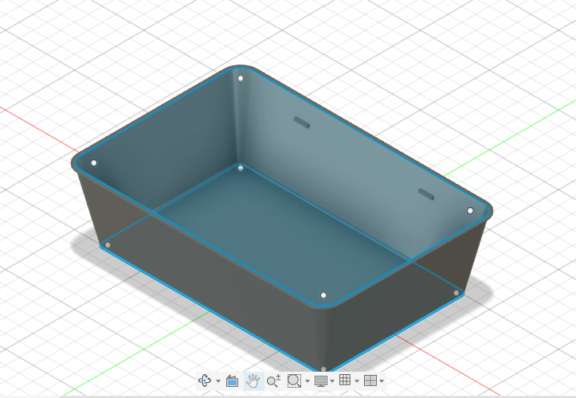
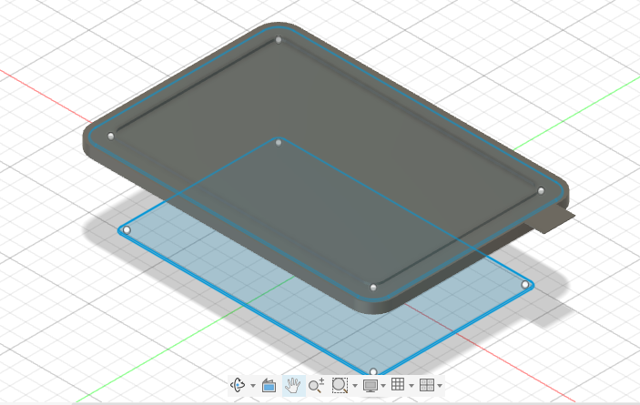
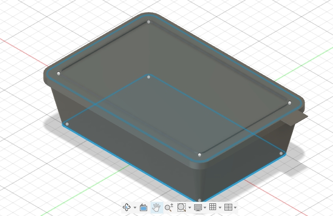

# 750 mL Clear Takeaway Container: Snap-Fit Lid with Plug Seal

**Parametric CAD design, drawing audit and digital fit verification**

| | |
|---|---|
| **Project** | Stackable clear takeaway pack, nominal 750 mL |
| **Drawing no.** | CTC-750-004 (Rev D as drawn; CAD has since been tuned, see [Current status](#current-status)) |
| **Tools** | Autodesk Fusion (parametric Part Design, Fusion API scripting); SVG for the drawing |
| **Assistance** | Claude (Anthropic) was used to audit the drawing and spec, and to script the fit-verification runs. All results below come from those runs. |
| **Validation status** | Digitally verified (rigid-body). **Physical prototype and leak testing not yet done.** |

**Quick links:** [Start here](START-HERE.md) · [Revision history](CHANGELOG.md) · [CAD files](cad/) · [Parameters](data/fusion_parameters.csv) · [Drawing](docs/CTC-750-004_revD_drawing.svg) · [Images](docs/images/)

---

## 1. Brief

Design a clear, stackable rectangular takeaway container (matched base and lid) that:

- holds about **750 mL** at the fill line,
- closes with a **snap-fit lid** (no gasket, no separate parts),
- resists leaks through an integral seal feature,
- opens without tools and stacks when filled.

The starting point was an existing concept drawing (Rev C) and a written specification. Before any CAD work, the brief was to check whether that drawing and spec were accurate and fit for purpose.

## 2. Design summary

| Feature | Value |
|---|---|
| Flange outside | 190 × 130 mm, R12 corners, 0.65 mm thick |
| Base height | 52 mm (bottom to flange top) |
| Footprint | 164 × 104 mm, R4 corners |
| Wall / floor | 0.65 mm each |
| Wall draft | 12.09° per side (derived from the geometry, not assumed) |
| 750 mL fill line | 39.31 mm above the inside floor (from the CAD cavity volume) |
| Lid | 0.5 mm nominal, 6 mm skirt, 0.30 mm clearance per side to the flange |
| Closure | 6 catch pads (30 mm long) under the flange, plus an integral tapered plug seal |
| Seal | Plug wall 3 mm deep, 0.5 mm thick, 0.10 mm radial interference |
| Opening aid | Thumb tab, 13 × 20 × 0.5 mm, on one short end |
| Stiffening and stacking | Lid ribs and a raised stacking ring (solid placeholders in CAD) |

Part volumes in the current model: base 30,700 mm³, lid 17,272 mm³. At an assumed PET density of 1.38 g/cm³ that is roughly 42 g and 24 g. This is an estimate only; confirm the sheet gauge with a thermoformer.

Full parameter table: [`data/fusion_parameters.csv`](data/fusion_parameters.csv). Drawing: [`docs/CTC-750-004_revD_drawing.svg`](docs/CTC-750-004_revD_drawing.svg).

## Model views

Screenshots of the current Fusion model (the tuned Rev D with release chamfer and thumb tab).

| Base | Lid with thumb tab |
|---|---|
|  |  |



*The blue outlines and white dots are Fusion's selection highlights, not part of the design.*

## 3. Process

### Step 1: Audit the Rev C drawing and spec

The spec and drawing were cross-checked and the key numbers recalculated before modelling.

**What held up:** flange and opening dimensions, floor size, lid clearance, closed height (52.5 mm) and the 750 mL capacity claim (about 749–752 mL by integrating the tapered well).

**Errors found in the drawing:**

- Section A–A was not to the stated dimensions: flange drawn about 2.5 mm thick and floor about 2 mm against 0.65 mm specified, wall taper about 7° against about 12° from the numbers, bottom width about 172 mm against 164 mm.
- The side elevation was straight-sided and 58 mm tall, against a 52.5 mm dimension.
- Corner radii were wrong: inner opening drawn R11.35 (offset geometry gives about R9.35); lid outer corner R13 (offset gives R12.8).
- Missing information: section cut marker, pad length and position, floor radii, draft angle, tolerances.
- Scale was labelled NTS while views were 1:1 and 8:1, and the sheet size was not a standard size.

**Design problems that would have failed testing:**

- No sealing feature: a flat lid on a flat flange cannot pass a leak test.
- Snap capture of 0.20 mm is smaller than normal thermoforming variation.
- An unribbed 0.5 mm flat lid over 185 × 125 mm would flex.
- No stacking location, and nesting risk for empty bases.
- The spec said at least 3° draft but the geometry is about 12°, and the 750 mL figure only holds at 12°.

### Step 2: Rev D redesign

- Redrew section and side views true to the spec, with a standard sheet, stated scales, a section marker and a parameter table.
- Raised snap capture from 0.20 to 0.50 mm (adjustable) with a 45° lead-in.
- Added an integral tapered plug seal, lid ribs, a stacking ring and nesting lugs.
- Re-derived the 750 mL fill line from the actual cavity volume (39.31 mm, not 39.47 mm).

### Step 3: Parametric build in Fusion

The base and lid are two bodies in one Part Design file, driven by a user-parameter table (`data/fusion_parameters.csv`). The test variables, `snap_capture`, `seal_depth`, `seal_interf` and `release_ch`, can be changed and the catch pads, plug and chamfer follow.

Note: the base and lid outlines are fixed sketches built from the table values. Changing `draft_slope`, the wall or the rim dimensions does not move them.

### Step 4: Digital assembly verification

Method, repeated after every design change:

1. Move the lid body along Z from 30 mm above the base down to seated, in steps (finer near first contact).
2. At each position run Fusion's interference analysis between base and lid.
3. Split the overlap into the **plug zone** (inside the opening) and the **pad zone** (catch pads and skirt at the flange edge) by intersecting the overlap with a box.
4. Repeat with the lid shifted sideways (0 to 0.5 mm) to test centering tolerance.
5. Remove the temporary move so the model is left unchanged.

In a rigid-body check, overlap volume stands in for the deflection the real PET would need. It shows where and how hard the parts interact, not real force. Raw numbers for every stage are in [`data/verification_results.csv`](data/verification_results.csv).

## 4. Iterations and results

Three changes were made in turn, each followed by a full re-test.

| Change | What changed | Result |
|---|---|---|
| **1. More capture** | `snap_capture` 0.5 → 0.8 mm | Catch under the flange rose to 0.8 mm (0.5 mm with the lid shifted 0.3 mm). Entry became abrupt: a 12.8 mm³ step at first contact. |
| **2. Smoother entry** | `pad_lead` 0.4 → 0.7 mm, `pad_h` 0.8 → 1.2 mm | Overlap now starts gently at 1.8 mm above closed (1.1 mm³) and rises steadily to a peak of about 85 mm³ at 0.8 mm. No jam point. |
| **3. Easier opening** | 0.2 mm 45° release chamfer on all six pad top edges (`release_ch`), plus a thumb tab | Seated state unchanged. Chamfer takes 0.2 mm off the flat catch (see below). |

### Final closing sequence (current model)

| Lid height above closed | Total overlap | Plug zone | Pad zone |
|---|---|---|---|
| 30 → 1.9 mm | 0 | 0 | 0 |
| 1.4 mm | 26 mm³ | 0 | 26 |
| 1.0 mm | 71 mm³ | 0 | 71 |
| 0.8 mm | 85 mm³ | 0 | 85 (peak pad overlap) |
| 0.4 mm | 82 mm³ | 28 | 54 |
| 0.2 mm | 128 mm³ | 102 | 25 |
| **0 mm (seated)** | **187.5 mm³** | **187.5** | **0** |

At seat, the catch pads have no overlap with the base and sit flush under the flange. The only overlap is the plug's designed 0.10 mm preload.

### Centering tolerance (lid shifted sideways when closed)

| Shift | Flat catch under flange | Result |
|---|---|---|
| 0 mm | 0.6 mm | Plug preload only |
| 0.3 mm (clearance limit) | **0.3 mm** | Plug overlap 257 mm³ |
| 0.4 mm | 0.2 mm | Lid skirt contacts the flange |

## 5. Current status

**What the checks support:** the lid enters without a jam point, seats fully, the catch pads end up under the flange, and the plug seal engages with the intended preload. All rigid-body, in CAD.

**What they do not show:** snap-in and pull-off force, how the PET flexes, whether the plug wall centers the lid, whether the seal holds liquid, and how the thumb tab peels the lid open. The model has no material behaviour (bodies carry a default material in Fusion), so none of this was simulated.

**Known weak point:** worst-case flat catch is **0.3 mm**. That is better than Rev D (0.2 mm) but still thin against thermoforming variation. Options: `snap_capture` 1.0 mm (restores 0.5 mm worst case at about 1.0 mm entry deflection), or a smaller `lid_clear`. Neither has been tried.

**Documents out of date:** drawing CTC-750-004 and the written spec predate Changes 1–3. They still show the Rev D values (capture 0.50, pad height 0.8, lead-in 0.4) and have no release chamfer or thumb tab. They need re-issuing as a new revision.

## 6. Next steps

1. Decide the capture/clearance trade-off, then re-run the same test.
2. Re-issue the drawing and spec at the new revision.
3. Print or thermoform two variants (for example `snap_capture` 0.8 and 1.0 mm) and compare closing effort, opening effort and holding.
4. Fill with coloured water and test for leaks (invert, shake, stack under load).
5. Replace the solid rib and ring placeholders with formed features and re-check nesting and stacking.

## 7. Repository contents

```
takeaway-container-750/
├── README.md
├── START-HERE.md                      # one-page guide for contractors
├── CHANGELOG.md                       # revision history
├── cad/
│   ├── takeaway-container-750.step    # opens in any CAD tool
│   └── takeaway-container-750.f3d     # editable in Autodesk Fusion
├── data/
│   ├── fusion_parameters.csv          # full Fusion parameter table (current values)
│   └── verification_results.csv       # raw results for all three test stages
└── docs/
    ├── CTC-750-004_revD_drawing.svg   # Rev D drawing (pre-tuning)
    └── images/                        # model screenshots
```

The two model files in `cad/` are exports of the current tuned model.

## 8. Contact

**Oluwatimileyin Oluleye**, CAD Designer
[oluwatimileyinoluleye@gmail.com](mailto:oluwatimileyinoluleye@gmail.com) · [LinkedIn](https://www.linkedin.com/in/oluwatimileyinoluleye)

Available for packaging and product design work, including drawing audits, parametric CAD and digital fit studies.
